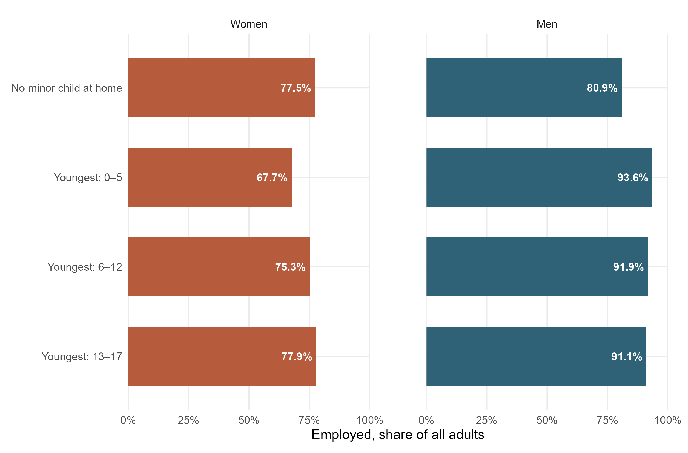
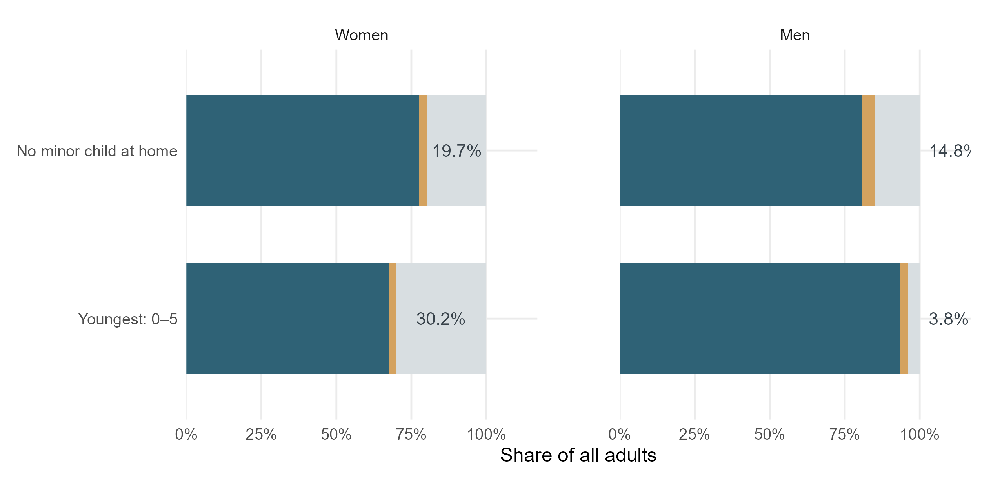
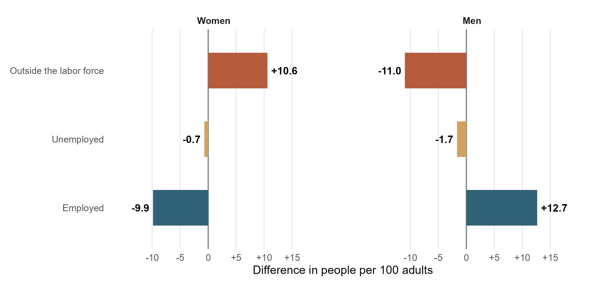

<style>
.newspaper-report {max-width:780px;margin:0 auto;color:#222;font-family:Georgia,"Times New Roman",serif;font-size:1.08rem;line-height:1.65;}
.newspaper-report > p {max-width:660px;margin:0 auto 1.15rem;}
.newspaper-report h2 {max-width:660px;margin:2.1rem auto 1rem;font-family:Georgia,"Times New Roman",serif;font-size:1.5rem;line-height:1.25;font-weight:700;color:#111;}
.newspaper-report .report-figure {display:block;float:none;box-sizing:border-box;width:100%;max-width:100%;margin:1.8rem 0 2rem;padding:0;border:0;}
.newspaper-report .report-figure figcaption {display:block;font:700 1.05rem/1.4 Arial,Helvetica,sans-serif;text-align:left;color:#111;margin:0 0 .3rem;}
.newspaper-report .figure-number {display:inline-block;margin-right:.4em;color:#666;font-weight:400;font-size:.85em;white-space:nowrap;}
.newspaper-report .figure-deck {font:.85rem/1.45 Arial,Helvetica,sans-serif;color:#666;margin:0 0 .65rem;}
.newspaper-report img.report-chart {display:block!important;float:none!important;box-sizing:border-box;width:100%!important;max-width:100%!important;height:auto!important;max-height:none!important;object-fit:contain;margin:0 auto!important;}
.newspaper-report .figure-legend {display:flex;flex-wrap:wrap;gap:.3rem 1rem;font:.78rem/1.5 Arial,Helvetica,sans-serif;margin:.5rem 0;}
.newspaper-report .legend-blue {border-left:10px solid #2f6276;padding-left:.35rem;}
.newspaper-report .legend-orange {border-left:10px solid #b65b3c;padding-left:.35rem;}
.newspaper-report .legend-green {border-left:10px solid #478578;padding-left:.35rem;}
.newspaper-report .legend-purple {border-left:10px solid #7b6388;padding-left:.35rem;}
.newspaper-report .legend-gray {border-left:10px solid #d8dee1;padding-left:.35rem;}
.newspaper-report .figure-source {font:.73rem/1.5 Arial,Helvetica,sans-serif;color:#777;margin:.4rem 0;}
.newspaper-report .report-figure details {font:.76rem/1.55 Arial,Helvetica,sans-serif;color:#666;margin-top:.45rem;}
.newspaper-report .report-figure summary {cursor:pointer;}
.newspaper-report .source-notes {font:.84rem/1.6 Arial,Helvetica,sans-serif;padding-left:1.5rem;}
.newspaper-report .source-notes li {margin-bottom:.8rem;scroll-margin-top:5rem;}
.newspaper-report a {overflow-wrap:anywhere;}
.newspaper-report sup {font-size:.7em;}
.newspaper-report .research-question {background:#fff0b3;color:inherit;padding:.08em .12em;box-decoration-break:clone;-webkit-box-decoration-break:clone;}
.newspaper-report pre {box-sizing:border-box;max-width:100%;overflow-x:auto;font-size:.76rem;line-height:1.5;}
@media(max-width:600px){.newspaper-report{font-size:1rem;}.newspaper-report h2{font-size:1.3rem;}.newspaper-report .report-figure{margin:1.3rem 0 1.6rem;}.newspaper-report .report-figure figcaption{font-size:.95rem;}.newspaper-report .figure-legend{font-size:.73rem;}}

body {max-width:900px;} main.content {max-width:900px;margin:auto;} header#title-block-header {max-width:780px;margin:0 auto 2rem;} .newspaper-report .model-spec,.newspaper-report .model-table {max-width:660px;margin:1.2rem auto;overflow-x:auto;} .newspaper-report table {font: .8rem/1.5 Arial,sans-serif;width:100%;border-collapse:collapse;} .newspaper-report th,.newspaper-report td {padding:.6em;border-bottom:1px solid #ddd;} .newspaper-report th {text-align:left;} .newspaper-report details.reproduction {font-size:.9rem;}

.newspaper-report .legend-gold {border-left:10px solid #d4a25f;padding-left:.35rem;} .newspaper-report .legend-lightblue {border-left:10px solid #a6b9c1;padding-left:.35rem;}
</style>

```{r}
#| label: setup
#| include: false
if (!requireNamespace("ggplot2", quietly=TRUE))
  stop("Install ggplot2: install.packages('ggplot2', repos='https://cloud.r-project.org')")
qmd_input <- if (isTRUE(getOption("knitr.in.progress"))) knitr::current_input(dir=TRUE) else NULL
project_dir <- if (length(qmd_input)==1L && nzchar(qmd_input)) {
  dirname(normalizePath(qmd_input, winslash="/", mustWork=FALSE))
} else normalizePath(getwd(), winslash="/")
raw_dir <- file.path(project_dir, "data", "raw")
processed_dir <- file.path(project_dir, "data", "processed")
figure_dir <- file.path(project_dir, "result", "figures")
result_dir <- file.path(project_dir, "result", "tables")
for (d in c(raw_dir,processed_dir,figure_dir,result_dir)) dir.create(d,recursive=TRUE,showWarnings=FALSE)
invisible(Sys.setlocale("LC_TIME", "C"))
run_id <- paste0(format(Sys.time(),"%Y%m%dT%H%M%S",tz="UTC"),"-",Sys.getpid())
writeLines(paste("STARTED",run_id,"— not a completed run"),file.path(result_dir,"run_status.txt"))
# Remove this program's stale aggregate outputs; keep validation documentation.
old_tables <- list.files(result_dir,pattern="[.](csv|txt)$",full.names=TRUE)
old_tables <- old_tables[!basename(old_tables) %in% c("validation_stage1.txt","run_status.txt")]
if(length(old_tables)) unlink(old_tables)

chart_theme <- function() ggplot2::theme_minimal(base_size=12) +
  ggplot2::theme(panel.grid.minor=ggplot2::element_blank(),
    panel.spacing=grid::unit(3.5,"lines"),legend.position="bottom",plot.margin=ggplot2::margin(12,18,10,10))

# reference: preview earlier supplied output explicitly; never the default.
# microdata: download/read IPUMS, recompute estimates, then generate report.
analysis_mode <- Sys.getenv("BLOG3_ANALYSIS_MODE","microdata")
if (!analysis_mode %in% c("reference","microdata")) stop("Unknown BLOG3_ANALYSIS_MODE")
```

```{r}
#| label: estimate-or-load
#| include: false
if (analysis_mode == "microdata") {
# Run this document in RStudio/Quarto. An IPUMS CPS account and API key are
# needed on the first render. Cached data can be used without the key later.
# Step 1: check R packages. The actual API key lives in your private R session.
required <- c("ipumsr", "dplyr", "srvyr", "survey", "ggplot2", "readr", "knitr")
missing <- required[!vapply(required, requireNamespace, logical(1), quietly = TRUE)]
if (length(missing)) {
  message("Installing missing R packages: ", paste(missing, collapse = ", "))
  tryCatch(
    utils::install.packages(missing, repos = "https://cloud.r-project.org",
                            type = if (.Platform$OS.type == "windows") "binary" else "source"),
    error = function(e) message("Automatic package installation failed: ", conditionMessage(e))
  )
  missing <- required[!vapply(required, requireNamespace, logical(1), quietly = TRUE)]
  if (length(missing)) {
    stop("These packages are still missing: ", paste(missing, collapse = ", "),
         ". In the RStudio Console, run install.packages(c(",
         paste(sprintf('"%s"', missing), collapse = ", "),
         "), repos = 'https://cloud.r-project.org'), then render again.", call. = FALSE)
  }
}
# Raw licensed records remain in the user's private cache.
raw_dir <- Sys.getenv("BLOG3_CACHE_DIR",file.path(path.expand("~"), ".ipums-cps-blog3-cache"))
derived_dir <- processed_dir
for(d in c(raw_dir,derived_dir,figure_dir)) dir.create(d,recursive=TRUE,showWarnings=FALSE)
# Step 3: use a complete local extract when available, otherwise request it.
ddi_files <- list.files(raw_dir, pattern = "^cps_[0-9]+[.]xml$", full.names = TRUE)
complete_ddi <- ddi_files[
  file.exists(sub("[.]xml$", ".csv.gz", ddi_files)) |
    file.exists(sub("[.]xml$", ".dat.gz", ddi_files))
]
explicit_ddi <- Sys.getenv("BLOG3_DDI_PATH", "")
if(nzchar(explicit_ddi)) {
 if(!file.exists(explicit_ddi)) stop("BLOG3_DDI_PATH does not exist")
 complete_ddi <- explicit_ddi
}
if (length(complete_ddi) > 1L)
  stop("More than one complete CPS extract is in the private cache; keep only the 2025 ASEC extract.")
if (length(complete_ddi) == 1L) {
  ddi_path <- complete_ddi[[1]]
} else {
  if (!nzchar(Sys.getenv("IPUMS_API_KEY"))) {
    stop("Set IPUMS_API_KEY in your own RStudio session and register for IPUMS CPS. ",
         "See README.md.", call. = FALSE)
  }
  request_path <- file.path(raw_dir, "extract_request.rds")
  ddi_path <- tryCatch({
    if (file.exists(request_path)) {
      submitted <- ipumsr::get_extract_info(readRDS(request_path))
    } else {
      extract <- ipumsr::define_extract_micro(
        collection = "cps",
        description = "Blog 3: young children and employment, 2025 ASEC",
        samples = "cps2025_03s",
        variables = c("YEAR", "AGE", "SEX", "YNGCH", "EMPSTAT", "EDUC",
                      "ASECWT", "REPWTP"),
        data_format = "csv", data_structure = "rectangular"
      )
      submitted <- ipumsr::submit_extract(extract)
      saveRDS(submitted, request_path)
    }
    ready <- ipumsr::wait_for_extract(submitted,max_delay_seconds=30,timeout_seconds=1800)
    ipumsr::download_extract(ready, download_dir = raw_dir, overwrite = TRUE)
  }, error = function(e) {
    if (grepl("Invalid IPUMS registration|not registered to IPUMS cps",
              conditionMessage(e), ignore.case = TRUE)) {
      stop("IPUMS API says the account associated with this R session's API key ",
           "does not have an active CPS registration. Check that the email in the ",
           "API error matches the email of your CPS website login and the account ",
           "where you copied the key: https://account.ipums.org/api_keys . ",
           "If they match and CPS says you are already registered, contact ",
           "IPUMS User Support at ipums@umn.edu with the 401 error (never send the key). ",
           "Original API message: ", conditionMessage(e), call. = FALSE)
    }
    stop(e)
  })
}
# Step 4: read the DDI and its accompanying compressed CSV into R.
cps_raw <- ipumsr::read_ipums_micro(ddi_path)
# Only structure is exported; no person values or rows are shared.
raw_schema <- data.frame(variable=names(cps_raw),
 class=vapply(cps_raw,function(x)paste(class(x),collapse="/"),character(1)),
 missing=vapply(cps_raw,function(x)sum(is.na(x)),integer(1)))
utils::write.csv(raw_schema,file.path(result_dir,"raw_structure.csv"),row.names=FALSE)
rep_names <- grep("^REPWTP[0-9]+$", names(cps_raw), value = TRUE)
stopifnot(all(c("YEAR", "AGE", "SEX", "YNGCH", "EMPSTAT", "EDUC", "ASECWT") %in%
              names(cps_raw)), length(rep_names) == 160L,
          all(as.numeric(cps_raw$YEAR) == 2025L))
# Step 5: recode child age, employment and controls; retain eligible adults.
# EMPSTAT general code 1 = employed; 2 = unemployed; 3 = not in labor force.
# YNGCH 99 = no identified own child living in the household.
# EDUC 999 = missing or unknown. EDUC 000 may also mean no schooling, so retain it.
empstat_general <- all(as.numeric(cps_raw$EMPSTAT)[!is.na(cps_raw$EMPSTAT)] %in% 0:3)
cps <- cps_raw |>
  dplyr::mutate(
    sex = factor(as.numeric(SEX), levels = c(1, 2), labels = c("Men", "Women")),
    child_group = dplyr::case_when(
      YNGCH == 99 | (YNGCH >= 18 & YNGCH <= 98) ~ "no_minor",
      YNGCH >= 0 & YNGCH <= 5 ~ "age0_5",
      YNGCH >= 6 & YNGCH <= 12 ~ "age6_12",
      YNGCH >= 13 & YNGCH <= 17 ~ "age13_17",
      TRUE ~ NA_character_
    ),
    child_group = factor(child_group,
                         levels = c("no_minor", "age0_5", "age6_12", "age13_17")),
    status = if(empstat_general) as.numeric(EMPSTAT) else floor(as.numeric(EMPSTAT) / 10),
    employed = as.numeric(status == 1),
    labor_force = as.numeric(status %in% c(1, 2)),
    unemployed = as.numeric(status == 2),
    age_band = factor(dplyr::case_when(
      AGE <= 34 ~ "25-34", AGE <= 44 ~ "35-44", TRUE ~ "45-54"
    ), levels = c("25-34", "35-44", "45-54")),
    college = factor(ifelse(EDUC >= 111, "BA or higher", "Below BA"),
                     levels = c("Below BA", "BA or higher"))
  ) |>
  dplyr::filter(AGE >= 25, AGE <= 54, !is.na(sex), !is.na(child_group),
                status %in% c(1, 2, 3), !is.na(EDUC), EDUC != 999,
                !is.na(ASECWT), ASECWT > 0)
if (!nrow(cps)) stop("No eligible records: inspect IPUMS variable codes.")
# Valid CPS replicate weights can be negative; do not reject them by sign.
if(any(!is.finite(as.matrix(cps[,rep_names])))) stop("Non-finite replicate weights")
utils::write.csv(as.data.frame(table(sex=cps$sex,child_group=cps$child_group)),
 file.path(result_dir,"unweighted_group_counts.csv"),row.names=FALSE)
utils::write.csv(data.frame(variable=names(cps),
 class=vapply(cps,function(x)paste(class(x),collapse="/"),character(1)),
 missing=vapply(cps,function(x)sum(is.na(x)),integer(1))),
 file.path(result_dir,"analytic_structure.csv"),row.names=FALSE)
# Audit the sample restriction. These are unweighted person records.
n_downloaded <- nrow(cps_raw)
n_prime_age <- sum(!is.na(cps_raw$AGE) & cps_raw$AGE >= 25 & cps_raw$AGE <= 54)
n_analytic <- nrow(cps)
stopifnot(n_analytic <= n_prime_age, n_prime_age <= n_downloaded)
# Step 6: make the ASEC person-weighted survey design with all 160 replicates.
design <- srvyr::as_survey_rep(
  cps, weights = ASECWT, repweights = dplyr::matches("^REPWTP[0-9]+$"),
  type = "successive-difference", mse = TRUE
)
# Step 7: estimate eight group rates and their design-based confidence intervals.
rates <- design |>
  dplyr::group_by(sex, child_group) |>
  dplyr::summarise(
    employment = srvyr::survey_mean(employed, vartype = "ci", na.rm = TRUE),
    participation = srvyr::survey_mean(labor_force, vartype = "ci", na.rm = TRUE),
    unemployment = srvyr::survey_ratio(unemployed, labor_force,
                                        vartype = "ci", na.rm = TRUE),
    .groups = "drop"
  ) |>
  as.data.frame()
readr::write_csv(rates, file.path(derived_dir, "weighted_rates.csv"))
# Consistency check: employment = participation * (1 - unemployment).
stopifnot(max(abs(rates$employment - rates$participation *
                    (1 - rates$unemployment))) < 1e-8)
utils::write.csv(data.frame(downloaded_person_records=n_downloaded,
 prime_age_person_records=n_prime_age,analytic_person_records=n_analytic),
 file.path(result_dir,"sample_audit.csv"),row.names=FALSE)

model <- survey::svyglm(
  employed ~ sex * child_group + age_band + college,
  design = design, family = stats::gaussian()
)
b <- stats::coef(model)
V <- stats::vcov(model)
ci_critical <- stats::qt(.975, df = 159) # 160 person replicates, 159 design df.
men_term <- "child_groupage0_5"
interaction_term <- "sexWomen:child_groupage0_5"
stopifnot(all(c(men_term, interaction_term) %in% names(b)))
contrast <- function(label, terms) {
  cvec <- stats::setNames(rep(0, length(b)), names(b))
  cvec[terms] <- 1
  estimate <- sum(cvec * b)
  se <- sqrt(as.numeric(t(cvec) %*% V %*% cvec))
  data.frame(group = label, estimate_pp = 100 * estimate,
             lower_pp = 100 * (estimate - ci_critical * se),
             upper_pp = 100 * (estimate + ci_critical * se), se_pp = 100 * se)
}
adjusted <- dplyr::bind_rows(
  contrast("Men", men_term),
  contrast("Women", c(men_term, interaction_term)),
  contrast("Women minus men", interaction_term)
)
readr::write_csv(adjusted, file.path(derived_dir, "adjusted_gaps.csv"))
capture.output(summary(model), file = file.path(result_dir, "model_summary.txt"))
capture.output(sessionInfo(), file = file.path(result_dir, "session_info_full_model.txt"))
adj_w <- adjusted$estimate_pp[adjusted$group == "Women"]
adj_m <- adjusted$estimate_pp[adjusted$group == "Men"]
interaction <- adjusted[adjusted$group == "Women minus men", ]
coefficients <- data.frame(term=names(b),estimate=as.numeric(b),se=sqrt(diag(V)),
 lower=as.numeric(b)-ci_critical*sqrt(diag(V)),upper=as.numeric(b)+ci_critical*sqrt(diag(V)))
utils::write.csv(data.frame(cps_year=2025,replicates=length(rep_names),
 design_df=survey::degf(design),contrast_df=159,model_rank=model$rank,
 min_fitted=min(stats::fitted(model)),max_fitted=max(stats::fitted(model))),
 file.path(result_dir,"model_diagnostics.csv"),row.names=FALSE)
utils::write.csv(data.frame(extract_file=basename(ddi_path),ddi_md5=unname(tools::md5sum(ddi_path)),
 analysis_timestamp_utc=format(Sys.time(),tz="UTC",usetz=TRUE)),
 file.path(result_dir,"extract_provenance.csv"),row.names=FALSE)
utils::write.csv(coefficients,file.path(result_dir,"model_coefficients.csv"),row.names=FALSE)

} else {

  rates <- utils::read.csv(file.path(project_dir,"data","reference_only","weighted_rates.csv"))
  adjusted <- utils::read.csv(file.path(project_dir,"data","reference_only","adjusted_gaps.csv"))
}
# Validate supplied aggregates before drawing or writing any interpretation.
required_rate_cols <- c("sex","child_group","employment","participation","unemployment")
stopifnot(all(required_rate_cols %in% names(rates)),nrow(rates)==8L,
 !anyDuplicated(paste(rates$sex,rates$child_group)),
 all(rates$sex %in% c("Men","Women")),
 all(rates$child_group %in% c("no_minor","age0_5","age6_12","age13_17")),
 all(as.matrix(rates[,c("employment","participation","unemployment")])>=0),
 all(as.matrix(rates[,c("employment","participation","unemployment")])<=1),
 max(abs(rates$employment-rates$participation*(1-rates$unemployment)))<1e-8)
stopifnot(nrow(adjusted)==3L,all(c("group","estimate_pp","lower_pp","upper_pp","se_pp") %in% names(adjusted)),
 all(adjusted$lower_pp<adjusted$estimate_pp),all(adjusted$upper_pp>adjusted$estimate_pp),
 abs(adjusted$estimate_pp[adjusted$group=="Women"]-
 adjusted$estimate_pp[adjusted$group=="Men"]-
 adjusted$estimate_pp[adjusted$group=="Women minus men"])<1e-8)
pick_rate <- function(s,g,col="employment") {
 row <- rates[rates$sex==s & rates$child_group==g,,drop=FALSE]
 if(nrow(row)!=1L) stop("Missing group")
 as.numeric(row[[col]])
}
e_w_young <- pick_rate("Women","age0_5");e_w_none <- pick_rate("Women","no_minor")
e_m_young <- pick_rate("Men","age0_5");e_m_none <- pick_rate("Men","no_minor")
women_gap <- 100*(e_w_young-e_w_none);men_gap <- 100*(e_m_young-e_m_none)
lf_w_young <- pick_rate("Women","age0_5","participation")
lf_w_none <- pick_rate("Women","no_minor","participation")
u_w_young <- pick_rate("Women","age0_5","unemployment")
u_w_none <- pick_rate("Women","no_minor","unemployment")
adj_w <- adjusted$estimate_pp[adjusted$group=="Women"]
adj_m <- adjusted$estimate_pp[adjusted$group=="Men"]
interaction <- adjusted[adjusted$group=="Women minus men",]
# Never force a preferred direction or statistical significance.
describe_gap <- function(x) if(abs(x)<.05) "roughly equal employment" else if(x<0) "lower employment" else "higher employment"
contrast_interval <- function(s) {
 z <- adjusted[adjusted$group==s,]
 if(z$lower_pp>0) "above zero" else if(z$upper_pp<0) "below zero" else "crosses zero"
}
same_direction <- sign(women_gap)==sign(men_gap)
# Exact status accounting: every share uses all adults as its denominator.
# E + unemployed share + outside-labor-force share = 1.
status_decomposition <- do.call(rbind,lapply(c("Women","Men"),function(sx) {
 en <- 100*pick_rate(sx,"no_minor");ey <- 100*pick_rate(sx,"age0_5")
 ln <- 100*pick_rate(sx,"no_minor","participation")
 ly <- 100*pick_rate(sx,"age0_5","participation")
 outside_contribution <- ly-ln
 unemployed_contribution <- -((ly-ey)-(ln-en))
 stopifnot(abs(outside_contribution+unemployed_contribution-(ey-en))<1e-8)
 data.frame(sex=sx,reference_employment=en,young_employment=ey,
 outside_contribution_pp=outside_contribution,
 unemployed_contribution_pp=unemployed_contribution,employment_gap_pp=ey-en)
}))
status_w <- status_decomposition[status_decomposition$sex=="Women",]
status_m <- status_decomposition[status_decomposition$sex=="Men",]
utils::write.csv(status_decomposition,file.path(result_dir,"employment_decomposition.csv"),row.names=FALSE)
fmt_pct <- function(x) sprintf("%.1f%%",100*x)
fmt_pp <- function(x) sprintf("%+.1f percentage points",x)
chart_colors <- c(Men="#2f6276",Women="#b65b3c")
child_labels <- c(no_minor="No minor child at home",age0_5="Youngest: 0–5",
 age6_12="Youngest: 6–12",age13_17="Youngest: 13–17")
utils::write.csv(rates,file.path(result_dir,"weighted_rates.csv"),row.names=FALSE)
utils::write.csv(adjusted,file.path(result_dir,"adjusted_gaps.csv"),row.names=FALSE)
# This edition's prose describes the supplied pattern; re-estimation must support it.
if(!(women_gap<0 && men_gap>0 && status_w$outside_contribution_pp<0 && status_w$unemployed_contribution_pp>0 &&
 status_m$outside_contribution_pp>0 && status_m$unemployed_contribution_pp>0 &&
 adj_w<0 && adj_m>0 && abs(adj_w-women_gap)<2 && abs(adj_m-men_gap)<2))
 stop("The new estimates do not support this edition's written findings. Review and revise the prose before publication.")
```

```{r}
#| label: model-table
#| include: false
model_comparison <- data.frame(
 Comparison=c("Men: young child vs no minor child", "Women: young child vs no minor child",
              "Difference between within-sex gaps (women minus men)"),
 raw_pp=c(men_gap,women_gap,women_gap-men_gap),
 adjusted_pp=adjusted$estimate_pp,
 adjusted_lower_pp=adjusted$lower_pp,adjusted_upper_pp=adjusted$upper_pp)
model_table <- data.frame(Comparison=model_comparison$Comparison,
 `Observed gap (pp)`=sprintf("%+.1f",model_comparison$raw_pp),
 `Adjusted gap (pp)`=sprintf("%+.1f",model_comparison$adjusted_pp),
 `Adjusted 95% interval (pp)`=sprintf("[%+.1f, %+.1f]",model_comparison$adjusted_lower_pp,model_comparison$adjusted_upper_pp),check.names=FALSE)
utils::write.csv(model_table,file.path(result_dir,"model_contrasts_display.csv"),row.names=FALSE)
utils::write.csv(model_comparison,file.path(result_dir,"model_comparison.csv"),row.names=FALSE)
```

```{r}
#| label: save-analysis
#| include: false
# Aggregate analysis objects only; no private credentials or person records.
object_names <- c("rates","adjusted","model_comparison","model_table","run_id","analysis_mode","e_w_young","e_w_none","e_m_young","e_m_none","women_gap","men_gap","lf_w_young","lf_w_none","u_w_young","u_w_none","adj_w","adj_m","interaction","status_decomposition","status_w","status_m","describe_gap","contrast_interval","fmt_pct","fmt_pp","chart_colors","child_labels","chart_theme")
analysis_env <- environment()
object_names <- object_names[vapply(object_names,function(x) exists(x,envir=analysis_env,inherits=FALSE),logical(1))]
saveRDS(mget(object_names,envir=analysis_env,inherits=FALSE),file.path(result_dir,"analysis_objects.rds"))
```

```{r}
#| label: fig-employment
#| include: false
fig1_data <- rates
fig1_data$sex <- factor(as.character(fig1_data$sex),levels=c("Women","Men"))
fig1_data$family <- factor(child_labels[as.character(rates$child_group)],levels=rev(unname(child_labels)))
fig1_data$value <- 100*rates$employment
p1 <- ggplot2::ggplot(fig1_data,ggplot2::aes(family,value,fill=sex))+
 ggplot2::geom_col(width=.66,show.legend=FALSE)+
 ggplot2::geom_text(ggplot2::aes(y=value-1.7,label=sprintf("%.1f%%",value)),hjust=1,color="white",fontface="bold",size=3.4)+
 ggplot2::facet_wrap(~sex,ncol=2)+ggplot2::coord_flip()+
 ggplot2::scale_fill_manual(values=chart_colors)+
 ggplot2::scale_y_continuous(limits=c(0,100),breaks=c(0,25,50,75,100),labels=function(x)paste0(x,"%"),expand=c(0,0))+
 ggplot2::labs(y="Employed, share of all adults",x=NULL)+chart_theme()
ggplot2::ggsave(file.path(figure_dir,"figure1_employment.png"),p1,width=8.5,height=5.6,dpi=300,bg="white")
p1
```

```{r}
#| label: fig-participation
#| include: false
states <- rbind(data.frame(rates[,c("sex","child_group")],state="Employed",share=rates$employment),
 data.frame(rates[,c("sex","child_group")],state="Unemployed",share=rates$participation-rates$employment),
 data.frame(rates[,c("sex","child_group")],state="Outside labor force",share=1-rates$participation))
states <- states[as.character(states$child_group) %in% c("no_minor","age0_5"),]
states$sex <- factor(as.character(states$sex),levels=c("Women","Men"))
states$state <- factor(states$state,levels=c("Employed","Unemployed","Outside labor force"))
states$family <- factor(child_labels[as.character(states$child_group)],levels=rev(unname(child_labels)))
stopifnot(all(states$share>=-1e-8))
p2 <- ggplot2::ggplot(states,ggplot2::aes(family,100*share,fill=state))+
 ggplot2::geom_col(width=.66,position=ggplot2::position_stack(reverse=TRUE))+
 ggplot2::geom_text(data=subset(states,state=="Outside labor force"),
 ggplot2::aes(y=ifelse(share<.16,103,100-50*share),label=sprintf("%.1f%%",100*share),hjust=ifelse(share<.16,0,.5)),color="#39434b",size=3.8)+
 ggplot2::facet_wrap(~sex,ncol=2)+ggplot2::coord_flip()+
 ggplot2::scale_fill_manual(values=c(Employed="#2f6276",Unemployed="#d4a25f",`Outside labor force`="#d8dee1"),name=NULL)+
 ggplot2::scale_y_continuous(limits=c(0,117),breaks=c(0,25,50,75,100),labels=function(x)paste0(x,"%"),expand=c(0,0))+
 ggplot2::labs(y="Share of all adults",x=NULL)+chart_theme()+
 ggplot2::theme(legend.position="none")
ggplot2::ggsave(file.path(figure_dir,"figure2_labor_force.png"),p2,width=8.5,height=4.1,dpi=300,bg="white")
p2
```

```{r}
#| label: fig-status-differences
#| include: false
fig3_data <- do.call(rbind,lapply(seq_len(nrow(status_decomposition)),function(i) {
 z <- status_decomposition[i,]
 data.frame(sex=z$sex,state=c("Outside the labor force","Unemployed","Employed"),
 difference=c(-z$outside_contribution_pp,-z$unemployed_contribution_pp,z$employment_gap_pp))
}))
utils::write.csv(fig3_data,file.path(result_dir,"state_share_differences.csv"),row.names=FALSE)
fig3_data$sex <- factor(fig3_data$sex,levels=c("Women","Men"))
fig3_data$state <- factor(fig3_data$state,levels=c("Employed","Unemployed","Outside the labor force"))
p3 <- ggplot2::ggplot(fig3_data,ggplot2::aes(x=difference,y=state,fill=state))+
 ggplot2::geom_vline(xintercept=0,color="#7a898f",linewidth=.6)+
 ggplot2::geom_col(width=.52,show.legend=FALSE)+
 ggplot2::geom_text(ggplot2::aes(x=difference+ifelse(difference>=0,.65,-.65),
 label=sprintf("%+.1f",difference),hjust=ifelse(difference>=0,0,1)),size=3.8,fontface="bold")+
 ggplot2::facet_wrap(~sex,ncol=2)+
 ggplot2::scale_fill_manual(values=c("Employed"="#2f6276","Outside the labor force"="#b65b3c","Unemployed"="#d4a25f"))+
 ggplot2::scale_x_continuous(limits=c(-16,18),breaks=c(-10,-5,0,5,10,15),labels=function(x)ifelse(x==0,"0",sprintf("%+g",x)))+
 ggplot2::labs(x="Difference in people per 100 adults",y=NULL)+chart_theme()+
 ggplot2::theme(panel.grid.major.y=ggplot2::element_blank(),strip.text=ggplot2::element_text(face="bold"))
ggplot2::ggsave(file.path(figure_dir,"figure3_status_differences.png"),p3,width=8.5,height=4.1,dpi=300,bg="white")
p3
```

```{r}
#| label: save-audit
#| include: false
utils::write.csv(data.frame(series="IPUMS CPS ASEC",sample="cps2025_03s",analysis_year=2025,
 frequency="Single ASEC cross-section",reason="Intentional 2025 comparison; no 2024-2026 trend estimated",
 analysis_mode=analysis_mode,read_timestamp_utc=format(Sys.time(),tz="UTC",usetz=TRUE)),
 file.path(result_dir,"data_coverage.csv"),row.names=FALSE)

capture.output(sessionInfo(),file=file.path(result_dir,"session_info_report.txt"))
utils::write.csv(data.frame(run_id=run_id,analysis_mode=analysis_mode,microdata_model_refitted=analysis_mode=="microdata",
 figures_regenerated=TRUE),file.path(result_dir,"execution_audit.csv"),row.names=FALSE)
```

```{r}
#| label: export-review-bundle
#| include: false
writeLines(paste("COMPLETE",run_id),file.path(result_dir,"run_status.txt"))
# Aggregate-only handoff: never copy raw microdata, .Renviron or request credentials.
review_dir <- file.path(project_dir,"result","review_for_codex")
dir.create(review_dir,recursive=TRUE,showWarnings=FALSE)
for(p in list.files(review_dir,full.names=TRUE)) if(!dir.exists(p)) unlink(p)
for(d in c(result_dir,figure_dir)) {
 files <- list.files(d,full.names=TRUE)
 files <- files[grepl("[.](csv|txt|png)$",files,ignore.case=TRUE)]
 if(length(files)) file.copy(files,review_dir,overwrite=TRUE)
}
file.copy(file.path(project_dir,"EDITORIAL_WINDOW.md"),review_dir,overwrite=TRUE)
writeLines(c(if(analysis_mode=="microdata") "Editorial status: MICRODATA RUN COMPLETED; review prose against results." else "Editorial status: REFERENCE PREVIEW; original microdata model not refitted.",
 "Send this folder (or its zip) for final analysis, interpretation and recommendations.",
 "Do not add raw CPS records, API keys or .Renviron."),file.path(review_dir,"HANDOFF.txt"))
if(requireNamespace("zip",quietly=TRUE)) {
 bundle <- file.path(project_dir,"result","review_for_codex.zip")
 zip::zipr(bundle,files=list.files(review_dir,full.names=TRUE),root=review_dir)
 message("Send: ",bundle)
} else message("Send the result/review_for_codex folder; zip it in Windows Explorer if needed.")
```

<style>
.newspaper-report .method-note{max-width:660px;margin:1.4rem auto;padding:1rem 1.2rem;border:1px solid #dce1e5;background:#f8fafb;font:.86rem/1.6 Arial,sans-serif;}
.newspaper-report .method-note>summary{cursor:pointer;font-weight:700;}
.newspaper-report .method-note p{margin:1rem 0;}
.newspaper-report .legend-observed{border-left:10px solid #899aa3;padding-left:.35rem;}
</style>

::::::: newspaper-report
A nursery pickup can clash with the end of a shift, making the fit between family life and paid work an everyday concern. Employment figures capture a striking contrast. Among women living with a child under six, employment is roughly ten percentage points lower than among women with no minor child at home—yet the share unemployed is slightly smaller. The larger difference is among adults outside the labor force.

<mark class="research-question"><strong>How does employment differ for women and men living with young children, and how much of that difference appears outside the labor force?</strong></mark>

The comparison covers adults aged 25–54, separating those whose youngest own child at home is aged 0–5 from those with no own child under 18 at home.<sup><a href="#note-1">1</a>, <a href="#note-2">2</a></sup> Women and men show opposite employment patterns. Looking at employed, unemployed and nonparticipating adults together makes those patterns easier to interpret than an employment rate alone.

<figure class="report-figure" aria-labelledby="figure-1-title">

<figcaption id="figure-1-title">

[Figure 1.]{.figure-number} Women’s employment is lowest where children are youngest

</figcaption>

<p class="figure-deck">

Employed per 100 adults, ages 25–54, 2025 survey reference week.

</p>



::: figure-legend
[Women]{.legend-orange}[Men]{.legend-blue}
:::

<p class="figure-source">

Source: <a href="https://cps.ipums.org/cps/">IPUMS CPS ASEC; author’s weighted estimates</a>. <a href="#note-1">Population and timing</a>.

</p>

<details>

<summary>Chart notes</summary>

<p>Child age means the youngest own child living at home. The reference group may include parents of adult or nonresident children. These are different groups of people, not families followed as children grow older.</p>

</details>

</figure>

## Lower employment for women, higher employment for men

Among women living with a young child, **`r fmt_pct(e_w_young)`** are employed, compared with **`r fmt_pct(e_w_none)`** among women with no minor child at home. The difference is **`r sprintf("%.1f",abs(women_gap))` percentage points**: about ten fewer employed women per 100. For men, the comparison runs the other way. Employment is **`r fmt_pct(e_m_young)`** in the young-child group and **`r fmt_pct(e_m_none)`** in the reference group, a **`r sprintf("%.1f",men_gap)`-point advantage**.

The older-child groups sharpen this contrast. Women’s employment rates are much closer to the reference when the youngest child is six or older; men’s rates remain above their reference across all three child groups. The female shortfall is therefore particularly pronounced where children are youngest, rather than appearing equally across all child ages.

A single employment average for women and men would conceal this split in paid work. Even separate employment rates leave an important distinction unresolved: whether adults without jobs are classified as unemployed or are outside the labor force.

## Three in ten women with young children are outside the labor force

The clearest contrast in Figure 2 is outside the labor force: **`r fmt_pct(1-lf_w_young)`** of women in the young-child group, against **`r fmt_pct(1-lf_w_none)`** in the reference group. These adults are neither employed nor classified as unemployed.<sup><a href="#note-3">3</a></sup>

<figure class="report-figure" aria-labelledby="figure-2-title">

<figcaption id="figure-2-title">

[Figure 2.]{.figure-number} Three in ten women with young children are outside the labor force

</figcaption>

<p class="figure-deck">

Each bar divides 100 adults into employed, unemployed and outside the labor force.

</p>



::: figure-legend
[Employed]{.legend-blue}[Unemployed]{.legend-gold}[Outside the labor force]{.legend-gray}
:::

<p class="figure-source">

Source: <a href="https://cps.ipums.org/cps/">IPUMS CPS ASEC; author’s weighted estimates</a>.

</p>

<details>

<summary>Chart notes</summary>

<p>Labels identify adults outside the labor force per 100 adults. The unemployed segment also uses all adults as its denominator; it is not the conventional unemployment rate, which uses only labor-force participants. Temporary layoffs are included under the applicable definition.</p>

</details>

</figure>

For men, the pattern again reverses. Just **`r fmt_pct(1-pick_rate("Men","age0_5","participation"))`** of the young-child group are outside the labor force, compared with **`r fmt_pct(1-pick_rate("Men","no_minor","participation"))`** in the reference group. High male employment sits alongside a much smaller nonparticipating share, while lower female employment sits alongside a larger one.

The outside-labor-force contrasts are clear, but the narrow unemployed segments are harder to compare by eye. Putting both on the same scale—differences per 100 adults—shows how much each category differs between the child groups.

## Ten more outside the labor force

For every 100 women, the young-child group has **`r sprintf("%.1f",abs(status_w$outside_contribution_pp))` more outside the labor force** but **`r sprintf("%.1f",status_w$unemployed_contribution_pp)` fewer unemployed** than the reference group. Those two differences correspond to **`r sprintf("%.1f",abs(women_gap))` fewer employed women**. Lower employment here accompanies a slightly smaller unemployed share, rather than a larger one.

<figure class="report-figure" aria-labelledby="figure-3-title">

<figcaption id="figure-3-title">

[Figure 3.]{.figure-number} The larger contrast is outside the labor force, for women and men alike

</figcaption>

<p class="figure-deck">

Young-child group minus the same-sex group with no minor child at home. Differences in people per 100 adults; positive means more, negative means fewer.

</p>



::: figure-legend
[Outside the labor force]{.legend-orange}[Unemployed]{.legend-gold}[Employed: corresponding difference]{.legend-blue}
:::

<p class="figure-source">

Source: author’s calculations from the same <a href="https://cps.ipums.org/cps/">IPUMS CPS ASEC</a> weighted group rates.

</p>

<details>

<summary>Reading the chart</summary>

<p>The first two rows compare the non-employed categories. The third shows the corresponding employment difference: the three signed differences sum to zero before rounding. The chart compares different groups of adults; it does not show people leaving work or estimate the effects of childcare.</p>

</details>

</figure>

The men’s comparison reinforces the distinction. Per 100 adults, the young-child group has **`r sprintf("%.1f",status_m$outside_contribution_pp)` fewer outside the labor force** and **`r sprintf("%.1f",status_m$unemployed_contribution_pp)` fewer unemployed**, alongside **`r sprintf("%.1f",men_gap)` more employed**. Despite the opposite employment patterns, the same finding holds for each sex: the outside-labor-force difference is larger than the unemployment difference.<sup><a href="#note-4">4</a></sup>

This comparison identifies the composition of the employment gap. It does not establish why participation differs. Childcare, working conditions and household circumstances may matter, but their separate roles are not measured here. Allowing for broad age and education differences changes the employment gaps only slightly; the supporting estimates are available below.<sup><a href="#note-5">5</a></sup>

## Takeaway

Women living with young children have employment **`r sprintf("%.1f",abs(women_gap))` percentage points lower** than their same-sex reference group; men have employment **`r sprintf("%.1f",men_gap)` points higher**. In both comparisons, differences outside the labor force are larger than differences in unemployment. For women, a smaller unemployed share even offsets a little of the employment shortfall.

These findings support reading employment and unemployment alongside nonparticipation when assessing work and family life. They do not identify which circumstances keep people outside the labor market or which policy would change that. **Read the employment gap alongside nonparticipation, not unemployment alone.**<sup><a href="#note-6">6</a></sup>

<details class="method-note">

<summary>A supporting check: does adjusting for age and education change the comparison?</summary>

The regression compares the child groups after allowing for broad age bands and bachelor’s-degree status. Women’s employment gap changes from **`r sprintf("%.1f",abs(women_gap))`** to **`r sprintf("%.1f",abs(adj_w))` points lower**; men’s from **`r sprintf("%.1f",men_gap)`** to **`r sprintf("%.1f",adj_m)` points higher**. Adjustment changes neither direction and little of the size, so it adds a modest check rather than a new explanation.

::: model-table
```{r}
#| label: display-model-table
#| include: true
knitr::kable(model_table,align=c("l","r","r","r"))
```
:::

The women’s adjusted contrast means about **`r sprintf("%.1f",abs(adj_w))` fewer employed women per 100** within the model’s age and education categories. The men’s contrast has the corresponding interpretation. The last row compares those two gaps; it is not the direct employment difference between women and men. These are adjusted associations, not effects of having children.

</details>

## Footnotes {#footnotes}

<ol class="source-notes">

<li id="note-1">

Figures are based on the 2025 <a href="https://cps.ipums.org/cps/">IPUMS CPS</a> survey, weighted to represent adults aged 25–54. Employment refers to the survey reference week.

</li>

<li id="note-2">

“Young child” means an own child aged 0–5 living at home. The comparison group has no own child under 18 at home; it includes some parents of older or nonresident children. Women and men are compared separately.

</li>

<li id="note-3">

All chart shares count people per 100 adults in the group. People outside the labor force are neither employed nor classified as unemployed. The usual unemployment rate instead counts unemployed people per 100 labor-force participants.

</li>

<li id="note-4">

Everyone falls into one of the three states, so more people in one must be balanced by fewer elsewhere. Small discrepancies in the displayed totals reflect rounding.

</li>

<li id="note-5">

The supporting comparison allows for broad age groups and bachelor’s-degree status. Details and uncertainty estimates accompany the code.

</li>

<li id="note-6">

The survey compares different people at one point in time. It does not follow families through childbirth or establish why their employment differs. Charts show estimates; confidence intervals are supplied with the results.

</li>

</ol>

## Reproducibility

**Edition status.** `r if(analysis_mode=="microdata") "The original microdata model was re-estimated in this execution." else "This review uses earlier aggregate estimates in data/reference_only; the original CPS microdata model was not re-estimated for this preview."`

`r if (exists("params") && nzchar(params[["repository-url"]])) paste0("The analysis code is available in the [GitHub repository](",params[["repository-url"]],").") else "The analysis code is included in the accompanying project."`

``` text
index.qmd
README.md
Blog3.Rproj
code/
  01_clean_analyze.R
  02_make_figures.R
  blog3_analysis.R
  install_packages.R
data/
  raw/              # placement instructions; licensed extracts remain private
  processed/        # weighted group rates and adjusted contrasts
result/
  figures/          # three figures generated from estimates
  tables/           # estimates, model diagnostics and execution audit
```

To reproduce the figures, open the website’s RStudio project and keep the post under `blog/posts/post3/`, retaining the folder structure. Keep the IPUMS CPS extract and its XML dictionary together in a private folder. Set `BLOG3_DDI_PATH` to the dictionary path for an existing extract; otherwise configure the private `IPUMS_API_KEY` and CPS registration as described in `README.md`.

Render `blog/posts/post3/index.qmd` to run the complete analysis and rebuild the article, including all three figures and the supporting model table. For standalone use, open `Blog3.Rproj` and render `index.qmd`. Running the scripts separately is optional: use `code/01_clean_analyze.R` followed by `code/02_make_figures.R`, or the combined `code/blog3_analysis.R`.

The scripts generate processed estimates, figures and model tables using project-relative output paths. The default mode refits from the 2025 ASEC microdata. Explicit reference mode uses earlier aggregate files in `data/reference_only/` for review; it does not reproduce a new microdata fit.
:::::::
