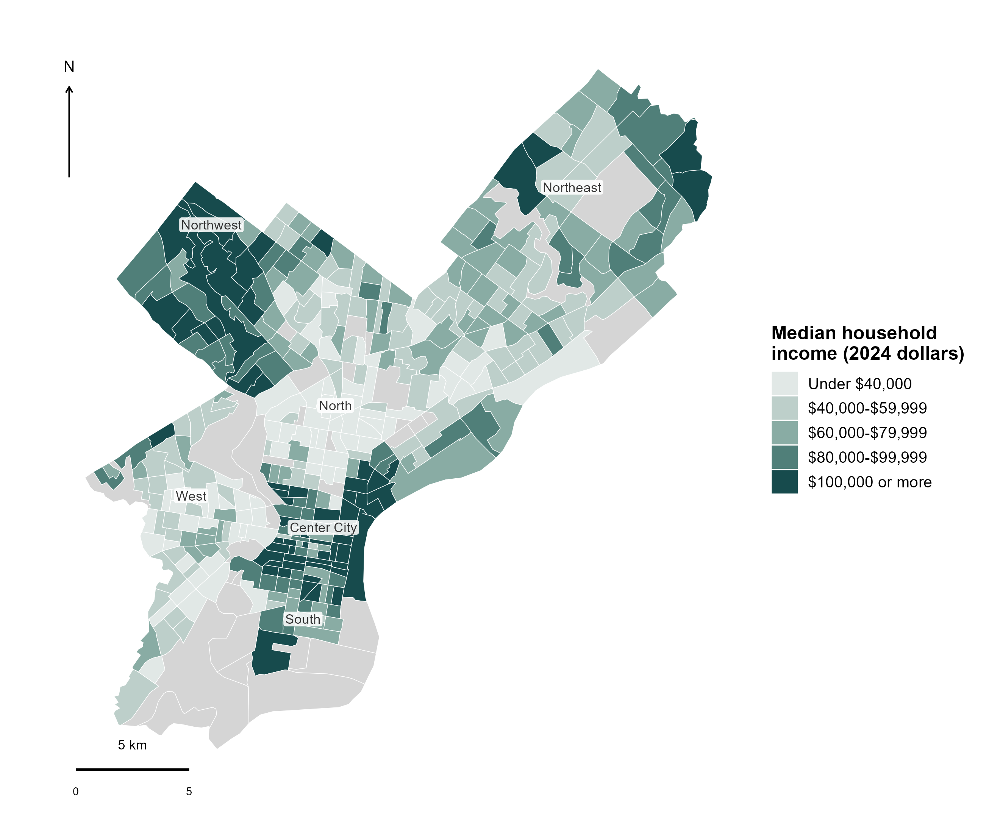
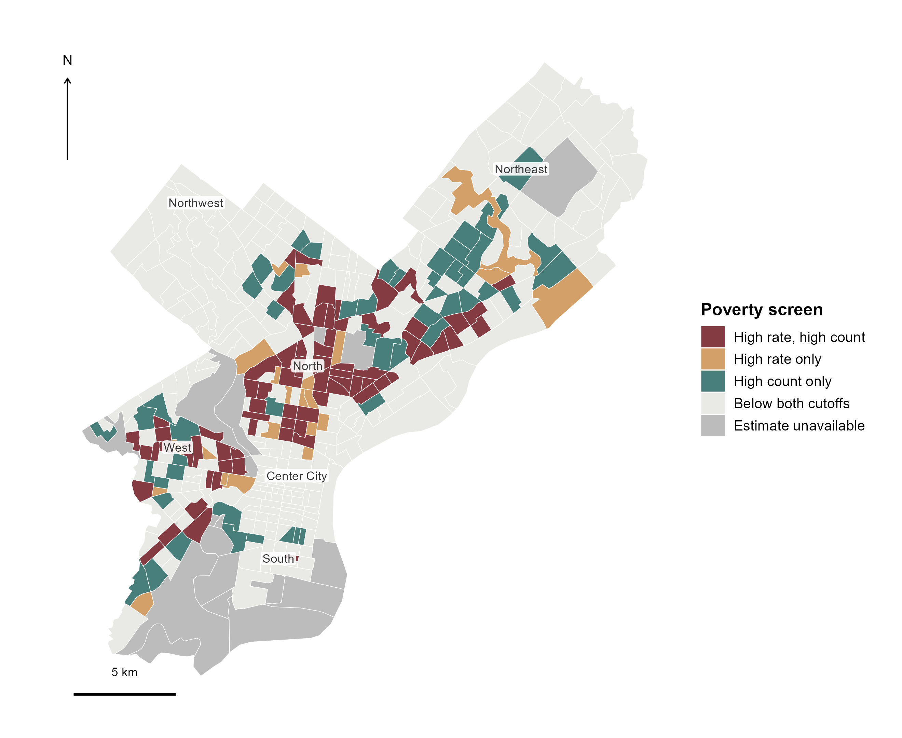
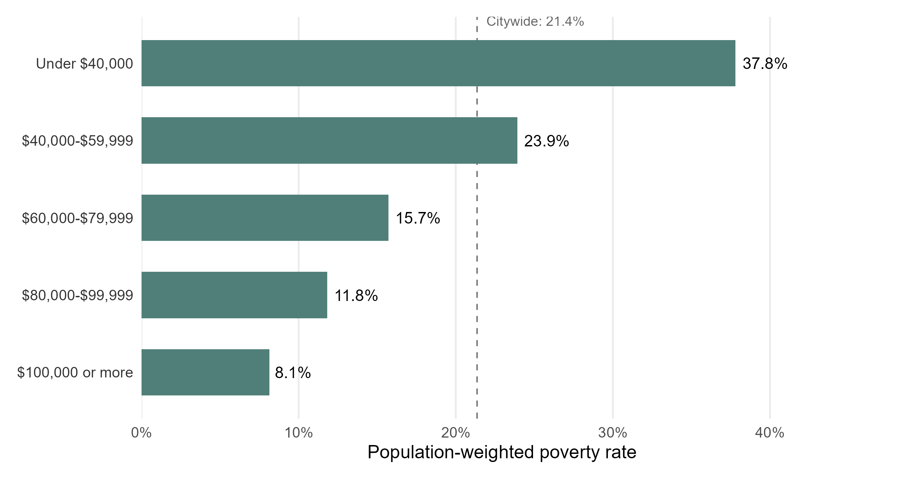

```{r}
#| label: generate-spatial-analysis
#| include: false
analysis_env <- environment()
input_file <- knitr::current_input(dir = TRUE)
input_dir <- if (length(input_file) == 1L && nzchar(input_file)) {
  dirname(normalizePath(input_file, winslash = "/", mustWork = FALSE))
} else character()
ancestor_dirs <- function(path) {
  out <- normalizePath(path, winslash = "/", mustWork = FALSE)
  repeat {
    parent <- dirname(tail(out, 1L))
    if (identical(parent, tail(out, 1L))) break
    out <- c(out, parent)
  }
  out
}
parents <- unique(unlist(lapply(c(input_dir, getwd()), ancestor_dirs)))
candidates <- unique(c(input_dir, getwd(), file.path(parents, "blog", "posts", "post5")))
required_scripts <- file.path("code", c("00_config.R", "01_acquire_data.R", "02_clean_analyze.R", "03_make_figures.R"))
coverage <- vapply(candidates, function(path) {
  sum(file.exists(file.path(path, required_scripts)))
}, integer(1))
post_dir <- candidates[which.max(coverage)]
missing_scripts <- required_scripts[!file.exists(file.path(post_dir, required_scripts))]
if (length(missing_scripts)) {
  stop(paste0(
    "Blog5 analysis scripts are missing or misplaced.\n",
    "Current execution directory: ", getwd(), "\n",
    "Expected post directory: ", post_dir, "\n",
    "Missing files:\n", paste(file.path(post_dir, missing_scripts), collapse = "\n"), "\n",
    "Copy the complete code/ folder from the Blog5 project ZIP beside index.qmd. ",
    "Keep data/ and result/ beside it as well. Replacing the QMD alone ",
    "does not install these external scripts."
  ), call. = FALSE)
}
post_dir <- normalizePath(post_dir, winslash = "/", mustWork = TRUE)
previous_dir <- getwd()
tryCatch({
  setwd(post_dir)
  source("code/02_clean_analyze.R", local = analysis_env, encoding = "UTF-8")
  source("code/03_make_figures.R", local = analysis_env, encoding = "UTF-8")
}, finally = setwd(previous_dir))
```

<style>
.blog5-report {max-width:780px;margin:0 auto;color:#222;font-family:Georgia,"Times New Roman",serif;font-size:1.08rem;line-height:1.65;}
.blog5-report > p {max-width:660px;margin:0 auto 1.15rem;}
.blog5-report h2 {max-width:660px;margin:2.1rem auto 1rem;font-family:Georgia,"Times New Roman",serif;font-size:1.5rem;line-height:1.25;font-weight:700;color:#111;}
.blog5-report .report-figure {display:block;float:none;box-sizing:border-box;width:100%;max-width:100%;margin:1.8rem 0 2rem;padding:0;border:0;}
.blog5-report .report-figure figcaption {display:block;font:700 1.05rem/1.4 Arial,Helvetica,sans-serif;text-align:left;color:#111;margin:0 0 .3rem;}
.blog5-report .figure-number {display:inline-block;margin-right:.4em;color:#666;font-weight:400;font-size:.85em;white-space:nowrap;}
.blog5-report .figure-deck {font:.85rem/1.45 Arial,Helvetica,sans-serif;color:#666;margin:0 0 .65rem;}
.blog5-report img.report-chart {display:block!important;float:none!important;box-sizing:border-box;width:100%!important;max-width:100%!important;height:auto!important;max-height:none!important;object-fit:contain;margin:0 auto!important;}
.blog5-report .figure-legend {display:flex;flex-wrap:wrap;gap:.3rem 1rem;font:.78rem/1.5 Arial,Helvetica,sans-serif;margin:.5rem 0;}
.blog5-report .legend-blue {border-left:10px solid #2f6276;padding-left:.35rem;}
.blog5-report .legend-orange {border-left:10px solid #b65b3c;padding-left:.35rem;}
.blog5-report .legend-green {border-left:10px solid #478578;padding-left:.35rem;}
.blog5-report .legend-purple {border-left:10px solid #7b6388;padding-left:.35rem;}
.blog5-report .legend-gray {border-left:10px solid #dedede;padding-left:.35rem;}
.blog5-report .figure-source {font:.73rem/1.5 Arial,Helvetica,sans-serif;color:#777;margin:.4rem 0;}
.blog5-report .report-figure details {font:.76rem/1.55 Arial,Helvetica,sans-serif;color:#666;margin-top:.45rem;}
.blog5-report .report-figure summary {cursor:pointer;}
.blog5-report .source-notes {font:.84rem/1.6 Arial,Helvetica,sans-serif;padding-left:1.5rem;}
.blog5-report .source-notes li {margin-bottom:.8rem;scroll-margin-top:5rem;}
.blog5-report a {overflow-wrap:anywhere;}
.blog5-report sup {font-size:.7em;}
.blog5-report .research-question {background:#fff0b3;color:inherit;padding:.08em .12em;box-decoration-break:clone;-webkit-box-decoration-break:clone;}
.blog5-report table {width:100%;border-collapse:collapse;font:.83rem/1.5 Arial,Helvetica,sans-serif;margin:1rem 0 1.5rem;}
.blog5-report th,.blog5-report td {padding:.5rem .35rem;border-bottom:1px solid #ddd;text-align:right;}
.blog5-report th:first-child,.blog5-report td:first-child {text-align:left;}
.blog5-report pre {box-sizing:border-box;max-width:100%;overflow-x:auto;font-size:.76rem;line-height:1.5;}
@media(max-width:600px){.blog5-report{font-size:1rem;}.blog5-report h2{font-size:1.3rem;}.blog5-report .report-figure{margin:1.3rem 0 1.6rem;}.blog5-report .report-figure figcaption{font-size:.95rem;}.blog5-report .figure-legend{font-size:.73rem;}}
</style>

::: {.blog5-report}

Philadelphia's poverty is concentrated enough to guide outreach, but too widespread for the poorest neighborhoods to define its limits. A joint screen of poverty rates and population counts identifies **`r summary$priority_tracts` tracts containing `r pct(summary$priority_poor_share)` of the city's people below poverty**. Yet targeting only places with median household incomes below $40,000 would leave most poverty outside the selected areas.

<mark class="research-question"><strong>Where could Philadelphia focus poverty outreach first, and how much need would a narrow geographic rule overlook?</strong></mark>

The answer is a two-part strategy: use concentrations of hardship to locate outreach, while keeping assistance accessible across the city. Matching income estimates, poverty counts and tract boundaries produces a practical screening list—and measures what each selection rule leaves out.<sup><a href="#note-6">6</a></sup>

<figure class="report-figure" aria-labelledby="figure-1-title">
<figcaption id="figure-1-title"><span class="figure-number">Figure 1.</span> Lower household incomes form a broad belt across North and West Philadelphia</figcaption>
<p class="figure-deck">Median household income by census tract, in 2024 dollars. Gray: income estimate unavailable.</p>

<p class="figure-source">Source: US Census Bureau, 2020–2024 ACS; author's calculations. 2024 TIGERweb tract boundaries.<sup><a href="#note-3">3</a></sup></p>
<details><summary>Chart notes</summary><p>All 408 tracts remain on the map; 375 have usable income estimates. Five fixed income bands classify point estimates. Both maps use EPSG:26918, the same extent and scale, with approximate orientation labels. Tracts are statistical areas, not named neighborhoods. See notes 1, 3 and 4.</p></details>
</figure>

## A fifth of residents, over a third of poverty

Philadelphia's median household income is `r dollars(summary$county_income)`.<sup><a href="#note-1">1</a></sup> Figure 1 shows why that single number is an inadequate guide to where outreach belongs: many lower-income tracts form a broad belt across North and West Philadelphia, between higher-income concentrations around Center City and the Northwest.

The imbalance is measurable. Among tracts with usable income estimates, the `r summary$low_tracts` tracts below $40,000 contain **`r pct(summary$low_population_share)` of the poverty-status population but `r pct(summary$low_poor_share)` of people below poverty**.<sup><a href="#note-5">5</a></sup> Poverty is disproportionately concentrated in these places, giving geographically focused outreach a clear rationale.

Their population-weighted poverty rate is `r pct(summary$low_rate)`, compared with `r pct(summary$high_rate)` in tracts at $100,000 or above—a `r formatC(summary$poverty_gap_pp,format="f",digits=1)` percentage-point gap. The issue is therefore more than a contrast in typical incomes: residents of the lower-income group face a substantially higher prevalence of poverty.

## 74 tracts offer a starting point

Where should outreach teams look first? Income alone is an indirect guide. A more direct screen combines **intensity**, the share of residents below poverty, with **caseload**, the number of people below poverty.<sup><a href="#note-2">2</a></sup>

For a transparent planning benchmark, select tracts with a poverty rate of at least 30% and at least 1,000 people below poverty. This identifies `r summary$priority_tracts` tracts containing `r number(summary$priority_poor)` people below poverty: `r pct(summary$priority_poor_share)` of the citywide total, in areas containing `r pct(summary$priority_population_share)` of the poverty-status population.

<figure class="report-figure" aria-labelledby="figure-2-title">
<figcaption id="figure-2-title"><span class="figure-number">Figure 2.</span> 74 tracts combine high poverty rates with at least 1,000 people below poverty</figcaption>
<p class="figure-deck">High rate: at least 30%. High count: at least 1,000 people. Each tract receives one category; gray does not mean no need.</p>

<p class="figure-source">Source: US Census Bureau, 2020–2024 ACS; author's calculations. 2024 TIGERweb tract boundaries.<sup><a href="#note-3">3</a></sup></p>
<details><summary>Chart notes</summary><p>Categories use B17001 counts and rates in 390 tracts. All 408 boundaries are retained; 18 have no usable rate. High rate/high count: 74 tracts; rate only: 22; count only: 52; below both cutoffs: 242. Cutoffs are explicit analytical choices for a planning screen, not official designations or eligibility criteria. See notes 2, 6 and 7.</p></details>
</figure>

The joint screen concentrates attention on specific tracts across North and West Philadelphia. High-count-only tracts also extend through the Northeast and South. A broad designation of the lowest-income parts of the city would therefore miss part of the caseload. The comparison separates these demands on services:

| Tract category | Tracts | Share of city's poverty population |
|:--|--:|--:|
| High rate and high count | `r coverage$tracts[1]` | `r pct(coverage$poor_share[1])` |
| High rate only | `r coverage$tracts[2]` | `r pct(coverage$poor_share[2])` |
| High count only | `r coverage$tracts[3]` | `r pct(coverage$poor_share[3])` |
| Below both cutoffs | `r coverage$tracts[4]` | `r pct(coverage$poor_share[4])` |

A rate-only map would place the `r summary$count_only_tracts` high-count tracts below the 30% threshold outside its high-poverty category, despite their containing `r pct(summary$count_only_poor_share)` of the city's poverty population. Conversely, the `r summary$rate_only_tracts` rate-only tracts contain `r pct(summary$rate_only_poor_share)`: severe local hardship, but smaller caseloads. Rates help identify intensity; counts help assess the scale of potential demand. Neither serves both purposes alone.

## An income cutoff would miss most poverty

The income gradient in Figure 3 is steep, but it does not justify restricting outreach to the lowest-income band.

<figure class="report-figure" aria-labelledby="figure-3-title">
<figcaption id="figure-3-title"><span class="figure-number">Figure 3.</span> Poverty falls with tract income, but remains present in every income band</figcaption>
<p class="figure-deck">Population-weighted poverty rates. The dashed line marks Philadelphia’s separately published county rate.</p>

<p class="figure-source">Source: US Census Bureau, 2020–2024 ACS; author's calculations. Groups are defined by tract income, not individual income.<sup><a href="#note-3">3</a></sup></p>
<details><summary>Chart notes</summary><p>For each income band, divide summed poverty counts by summed poverty-status population. All 375 tracts with both measures are included, covering 97.3% of the city’s poverty-status population. The bars show rates, not shares of the city’s poor. The separate 63.7% figure in the text is calculated from counts. See notes 4 and 5.</p></details>
</figure>

Within the complete-case comparison, **`r pct(summary$income_screen_missed_share)` of people below poverty live in tracts with median household incomes of at least $40,000**—outside an under-$40,000 geographic screen. A typical household's income does not describe every household around it. Even the highest-income band has a poverty rate of `r pct(summary$high_rate)`.

The joint screen exposes another weakness in income-only selection. Of its `r summary$priority_tracts` high-rate, high-count tracts, `r summary$priority_above_income_cutoff` have median incomes at or above $40,000, while `r summary$priority_missing_income` lack a usable income estimate altogether. Poverty counts keep these places visible. An income requirement would exclude or leave them unclassified despite substantial measured need.

## Target outreach. Keep access citywide.

The practical output is a GEOID-linked list of `r summary$priority_tracts` tracts for an initial review of outreach locations, accompanied by a separate high-count category that captures another `r pct(summary$count_only_poor_share)` of poverty. The list can support comparing proposed sites with concentrations of potential demand. Individual access to assistance should remain based on household circumstances, with citywide routes for residents outside the selected areas.

The size of the initial screen depends on the chosen threshold. Holding the 1,000-person cutoff fixed makes that tradeoff explicit:<sup><a href="#note-7">7</a></sup>

| Minimum poverty rate | Selected tracts | Share of city's poverty population |
|:--|--:|--:|
| 25% | `r sensitivity$tracts[1]` | `r pct(sensitivity$poor_share[1])` |
| 30% | `r sensitivity$tracts[2]` | `r pct(sensitivity$poor_share[2])` |
| 35% | `r sensitivity$tracts[3]` | `r pct(sensitivity$poor_share[3])` |

A stricter definition concentrates attention on fewer places while reducing the poverty population inside the screen. Choosing 30% is a visible planning assumption, not an estimated optimum. ACS sampling uncertainty also makes the list a starting point for local review rather than a precise ranking.<sup><a href="#note-4">4</a></sup>

## Conclusion and outlook

Philadelphia's poverty is concentrated enough to guide outreach, but extends well beyond its lowest-income neighborhoods. The joint poverty-rate and population-count screen identifies 74 tracts containing 39.2% of the city's poverty population. Yet an under-$40,000 tract-income cutoff would omit 63.7% of people below poverty in the income-complete sample.

Together, these findings support focused outreach alongside citywide access to assistance. Poverty rates identify intensity; counts reveal the scale of need; threshold comparisons expose the coverage tradeoff. The next step is to compare these areas with service capacity and travel access, then track participation to assess whether focused outreach improves residents' access to support.

## Takeaway

Philadelphia can focus initial outreach on 74 tracts containing 39.2% of its poverty population, while explicitly reviewing the substantial caseloads elsewhere. The under-$40,000 income screen would overlook most poverty in the comparable sample. **Use geography to place services; keep household need at the center of access.**

## Footnotes {#footnotes}

<ol class="source-notes">
<li id="note-1"><strong>Income, geography and time.</strong> B19013 reports median household income in 2024 inflation-adjusted dollars. The 2024 ACS five-year release pools observations from 2020–2024; it is not a single-year 2024 reading or a measure of conditions in October 2026. Census tracts are small statistical subdivisions of counties, not identical to named neighborhoods. Philadelphia County is the geographic scope. Sources: <a href="https://data.census.gov/table/ACSDT5Y2024.B19013">B19013</a> and <a href="https://www.census.gov/programs-surveys/acs/guidance/estimates.html">Census guidance on period estimates</a>.</li>
<li id="note-2"><strong>Poverty and its denominator.</strong> B17001 reports people below the official poverty threshold and the population for whom poverty status is determined. The latter excludes some populations, including people in institutional group quarters and college dormitories. The threshold depends on family size and composition; it is not the $40,000 tract-income cutoff. This is the official poverty measure, not a local cost-of-living or disposable-income measure. See <a href="https://data.census.gov/table/ACSDT5Y2024.B17001">B17001</a> and <a href="https://www.census.gov/topics/income-poverty/poverty/guidance/poverty-measures.html">Census poverty-measure definitions</a>.</li>
<li id="note-3"><strong>Sources and spatial processing.</strong> Published Census table-based Summary Files supply B19013 and B17001. Only original Philadelphia County and tract rows are retained, alongside source URLs, retrieval records and source/subset hashes. Official <a href="https://tigerweb.geo.census.gov/arcgis/rest/services/Generalized_ACS2024/Tracts_Blocks/MapServer/4">2024 generalized TIGERweb tract polygons</a> are queried for state 42, county 101 and returned in EPSG:26918. Eleven-digit GEOIDs join estimates to geometry; all 408 tracts match exactly once. Polygon rings, including holes, are preserved. Boundaries are generalized for thematic mapping and do not identify property lines. See the <a href="https://www.census.gov/programs-surveys/acs/data/summary-file.2024.html">Summary File documentation</a>.</li>
<li id="note-4"><strong>Missing values and uncertainty.</strong> Negative Census sentinel codes are converted to missing values, never zero. Income is available for 375 tracts and poverty rates for 390; unavailable income estimates appear in gray in Figure 1, while Figure 2 distinguishes unavailable rates from tracts below both screening cutoffs. ACS income margins of error use the Census standard 90% confidence level. An income estimate plus or minus its published margin gives the corresponding interval; 317 of the 375 income intervals cross at least one displayed income-band boundary. No significance is inferred from map adjacency. Grouped poverty rates are descriptive point estimates, with no confidence intervals calculated. See <a href="https://www.census.gov/programs-surveys/acs/methodology/sample-size-and-data-quality/sample-size-definitions.html">Census sampling-error definitions</a>.</li>
<li id="note-5"><strong>Weights and interpretation.</strong> Figure 3 divides the sum of people below poverty by the sum of the poverty-status population in each tract-income band. It covers 375 tracts, representing 97.3% of that population across all 408 tracts. The 20.0% population share, 36.3% poverty share and complementary 63.7% outside the under-$40,000 band all use this same complete-case scope. The 63.7% is not a share of the entire county poverty population: the income-complete comparison excludes tracts without a usable income estimate. Joint-screen shares instead use all county poverty counts. Tract population and poverty totals separately reproduce the county counts. Tract medians are not averaged to create the county median; the county estimate is read directly. The analysis is cross-sectional and ecological: it does not estimate an individual relationship, causal neighborhood effects, changes over time or a formal spatial clustering statistic.</li>
<li id="note-6"><strong>Joint screening and deliverables.</strong> The analysis defines high rate as B17001 poverty rate ≥30% and high count as B17001 people below poverty ≥1,000. These illustrative thresholds are analytical choices, not official poverty-area designations, optimized allocations or benefit-eligibility rules. The four categories partition the 390 tracts with usable poverty rates. Their counts sum to the county poverty count; shares use the county denominator, unlike the income comparison's complete-case denominator. Eighteen tracts have no usable poverty rate and zero published poverty-status population. <code>tract_priority_screen.csv</code> retains all 408 tracts; <code>priority_tracts.csv</code> contains the 74 jointly selected tracts, ordered by poverty count for auditing rather than a claim of optimal priority; <code>screen_coverage.csv</code> reports the four-category comparison. No service-capacity, cost, take-up or treatment-effect data are used, so population inside the screen is not predicted enrollment or poverty reduction.</li>
<li id="note-7"><strong>Threshold sensitivity.</strong> <code>screen_sensitivity.csv</code> repeats the joint rule at poverty rates of 25%, 30% and 35%, always requiring at least 1,000 people below poverty. This tests the consequences of alternative rate cutoffs, not robustness to sampling error, alternative count cutoffs or geographic aggregation. Counts, rates and classifications are ACS point estimates; no confidence intervals for screened coverage are calculated. The maps and screen describe the 2020–2024 period. Later service-access evaluation is proposed work, not an outcome established here.</li>
</ol>

## Reproducibility

The analysis code, frozen data and generated results are included in the accompanying project. The standalone repository uses the following structure:

```text
index.qmd
index.html
README.md
Blog5.Rproj
code/
├── 00_config.R                  # paths, cutoffs and source URLs
├── 01_acquire_data.R            # Census downloads and tract subsets
├── 02_clean_analyze.R           # joins, coverage and sensitivity
├── 03_make_figures.R            # income map, joint screen and rate chart
├── blog5_analysis.R             # run the complete R workflow
└── render_html.R                # optional knitr/Pandoc fallback
data/
├── raw/
│   ├── b19013_philadelphia.dat   # original income table rows
│   ├── b17001_philadelphia.dat   # original poverty table rows
│   ├── tract_boundaries_2024.json # projected official tract polygons
│   ├── source_manifest.json     # table provenance and hashes
│   └── boundary_manifest.json   # boundary query and provenance
└── processed/
    ├── tract_estimates.csv      # joined estimates and uncertainty
    └── map_vertices.csv         # polygon vertices and ring IDs
result/
├── figures/
│   ├── figure1_income_map.png   # 300-dpi Figure 1
│   ├── figure2_poverty_map.png   # 300-dpi Figure 2
│   └── figure3_income_poverty.png # 300-dpi Figure 3
└── tables/
    ├── priority_tracts.csv       # 74-tract planning shortlist
    ├── tract_priority_screen.csv # all 408 tracts and categories
    ├── screen_coverage.csv       # rate/count coverage comparison
    ├── screen_sensitivity.csv   # alternative rate thresholds
    └── ...                     # income comparisons and audits
```

To reproduce the figures, open the website's RStudio project and place the full post under `blog/posts/post5/`, retaining the folder structure and saved inputs in `data/raw/`.

Run `blog/posts/post5/code/02_clean_analyze.R`, followed by `blog/posts/post5/code/03_make_figures.R`. Render `blog/posts/post5/index.qmd` to rebuild the article. Alternatively, open the supplied `Blog5.Rproj`, run the scripts from `code/`, and render `index.qmd`.

The scripts generate the tract screen, coverage and sensitivity tables, processed estimates and figures using project-relative paths. Cached inputs are used by default; the public Census Summary Files and TIGERweb query support programmatic reacquisition without an API key. Download URLs and snapshot records are included in the manifests and `README.md`.

:::
