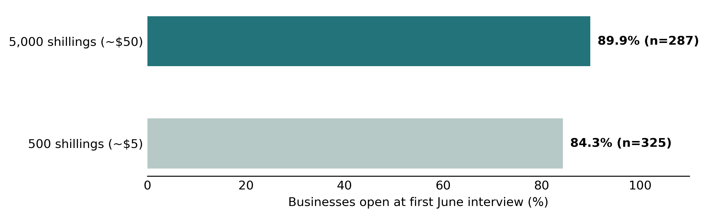
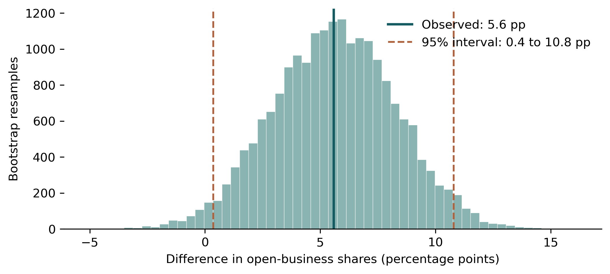
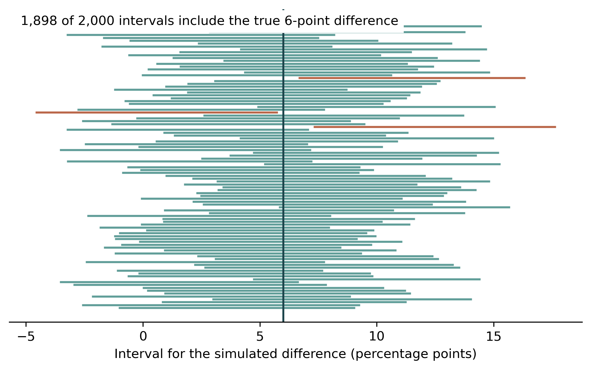

```{r}
#| label: rebuild-blog8
#| include: false
# Rebuild data and figures, then load values used by the article below.
input <- knitr::current_input(dir = TRUE)
post_dir <- if (length(input) && nzchar(input)) dirname(normalizePath(input, winslash = "/")) else getwd()
if (!file.exists(file.path(post_dir, "code", "analysis.py"))) stop("Keep code/ and data/ beside index.qmd.")
python <- Sys.getenv("BLOG8_PYTHON", unset = "")
if (!nzchar(python)) python <- Sys.getenv("RETICULATE_PYTHON", unset = "")
if (!nzchar(python)) python <- Sys.which("python")
if (!nzchar(python)) python <- Sys.which("python3")
if (!nzchar(python)) stop("Python not found. See README.md and set BLOG8_PYTHON if needed.")
log <- tempfile(fileext = ".txt")
status <- system2(python, args = shQuote(file.path(post_dir, "code", "analysis.py")), stdout = log, stderr = log)
if (!identical(status, 0L)) stop(paste0("Blog8 analysis failed: ", paste(readLines(log, warn = FALSE, encoding = "UTF-8"), collapse = "\n")))
result <- read.csv(file.path(post_dir, "result", "tables", "summary.csv"), check.names = FALSE)[1, ]
q_json <- paste(readLines(file.path(post_dir, "result", "tables", "interactive_quantiles.json"), warn = FALSE, encoding = "UTF-8"), collapse = "")
histogram_json <- paste(readLines(file.path(post_dir, "result", "tables", "interactive_histogram.json"), warn = FALSE, encoding = "UTF-8"), collapse = "")
fmt <- function(x) sprintf("%.1f", x)
```

<style>
*{box-sizing:border-box}html{background:white;color:#222}body{margin:0}main{max-width:828px;margin:0 auto;padding:44px 24px 64px}header{max-width:660px;margin:0 auto 40px;font-family:Arial,sans-serif}h1{font:600 36px/1.17 Arial,sans-serif;letter-spacing:-.6px;margin:0 0 13px}.subtitle{font:21px/1.45 Arial,sans-serif;color:#595959;margin:0 0 15px}.tags{font:11px Arial;color:#626970;letter-spacing:.3px;margin:0 0 25px}.tags span{display:inline-block;border:1px solid #a9afb4;border-radius:3px;padding:4px 7px;margin:0 5px 6px 0}.meta{display:flex;gap:100px;font:14px Arial}.meta small{display:block;color:#777;font-size:11px;margin-bottom:6px}article{font:17px/1.67 Georgia,serif;max-width:780px;margin:auto}article>p,article>h2,article>aside,article>section{max-width:660px;margin-left:auto;margin-right:auto}article>p{margin-bottom:1.1em}h2{font:700 24px/1.3 Georgia,serif;margin-top:2em}mark{background:#fff0b3;padding:2px}figure{margin:32px 0}figcaption{font:700 16px/1.4 Arial,sans-serif}figure img{display:block;width:100%;height:auto}.note{font:12px/1.5 Arial;color:#666}a{color:#246e77}.interactive{font:14px/1.5 Arial;background:#f6f8f7;border-top:2px solid #23737a;padding:16px;margin:16px 0}input{width:min(300px,100%);accent-color:#23737a}.footnotes{border-top:1px solid #ccc;font:13px/1.6 Arial;color:#555;margin-top:36px;padding-top:10px}.repro{border-top:1px solid #ccc;font:13px/1.6 Arial;color:#555;margin-top:30px;padding-top:12px}sup{font-size:.7em}@media(max-width:600px){main{padding:28px 18px}h1{font-size:30px}.meta{gap:45px}article{font-size:16px}}
#title-block-header{display:none}</style>

<main><header><h1>How Certain Is the Evidence? A Bootstrap Analysis of Cash Transfers and Women-Owned Businesses in Kenya</h1><p class="subtitle">Using a 2020 Kenyan experiment to understand confidence intervals and hypothesis tests</p><div class="tags"><span>SIMULATION</span><span>BOOTSTRAP</span><span>DEVELOPMENT ECONOMICS</span></div><div class="meta"><div><small>AUTHOR</small>Scarlett Xie</div><div><small>DATA</small>Kenya, 2020</div></div></header><article>
<p>During the first wave of COVID-19, customers disappeared from markets in Dandora, a neighborhood in Nairobi, Kenya. For women running small businesses, a sudden loss of sales threatened both daily income and the money needed to restock. Researchers tested whether a one-time cash transfer could help. Among those interviewed, <strong>`r fmt(100*result$share_high)`% of the 5,000-shilling group were open, compared with `r fmt(100*result$share_low)`% of the 500-shilling group</strong>—a difference of `r fmt(result$gap_pp)` percentage points.</p>
<p><mark><strong>How certain is the observed difference in business-open shares between women who received larger and smaller cash transfers?</strong></mark></p>
<p>A single comparison cannot show how precisely that gap is measured. Resampling provides an interval for the difference, and a simulated no-effect benchmark shows how unusual a gap this large would be under a specified model.<sup><a href="#fn1">1</a></sup></p>
<h2>Two transfers, one economic shock</h2>
<p>In May 2020, researchers randomly assigned women microenterprise owners to receive a one-time payment. The larger-transfer group received 5,000 Kenyan shillings (about $50); the comparison group also received money: 500 shillings (about $5), to cover participation and phone costs. Neither payment depended on the owner’s business decisions. To make a common comparison, I use each participant’s first valid interview in June 2020. Among respondents, `r result$open_high` of `r result$n_high` businesses in the higher-transfer group were open, compared with `r result$open_low` of `r result$n_low` in the comparison group. That is `r fmt(100*result$share_high)`% versus `r fmt(100*result$share_low)`%: an observed difference of <strong>`r fmt(result$gap_pp)` percentage points</strong>.</p>
<figure><figcaption>Figure 1. More higher-transfer businesses were open in June</figcaption><p class="note">Each business contributes its first valid June interview. Source: Brooks and colleagues’ replication data; author’s calculations.</p></figure><p>The `r fmt(result$gap_pp)`-percentage-point difference means that, for every 100 women interviewed, roughly six more businesses were open in the 5,000-shilling group. This comparison is our starting point. Bootstrap resampling helps show how precisely the gap is measured.<sup><a href="#fn2">2</a></sup></p>
<h2>Resampling puts a range around the gap</h2>
<p>To gauge how much the `r fmt(result$gap_pp)`-point gap might vary, I use a method called <strong>bootstrap resampling</strong>. First, I draw businesses at random from each group, allowing the same business to be selected more than once. Then I calculate the gap again. Repeating these steps 20,000 times produces the range of gaps in Figure 2.</p>
<p>The middle 95% of these gaps runs from <strong>`r fmt(result$ci_low_pp)` to `r fmt(result$ci_high_pp)` percentage points</strong>. This interval describes the uncertainty around the difference in open-business shares for the June respondent comparison.<sup><a href="#fn3">3</a></sup></p>
<figure><figcaption>Figure 2. Resampling the businesses produces a range of gaps</figcaption><div id="bootstrap-chart" role="img" aria-label="Bootstrap distribution with adjustable confidence interval"></div><noscript></noscript><div class="interactive"><label for="level"><strong>Explore Figure 2:</strong> confidence level <output id="lv">95</output>%</label><br><input type="range" id="level" min="80" max="99" value="95" step="1"><p id="out" aria-live="polite"></p><div class="note">Move the slider to see how the bootstrap interval changes. The observed gap stays the same.</div></div><p class="note">20,000 resamples, independently within groups. At the default 95% setting, the dashed lines mark the 2.5th and 97.5th percentiles; the slider changes these percentiles. One business, not one interview, is the resampling unit.</p></figure><p>The 95% interval lies above zero, pointing to a higher open-business share in the 5,000-shilling group under this resampling approach. Its lower endpoint is close to zero, so the results are also consistent with a very small difference. A positive interval is evidence of a difference, not proof that a difference or a causal effect must exist.</p>

<h2>What a 95% interval captures</h2>
<p>The true difference in the population of interest is unknown, so the real sample cannot tell us whether its interval contains that value. Instead, imagine a separate population in which 90% of higher-transfer businesses and 84% of comparison businesses are open: the true difference is six points. I repeatedly draw two independent samples of the same sizes as above and rebuild the bootstrap interval for each pair.<sup><a href="#fn4">4</a></sup></p>
<p>A 95% procedure does not promise that every interval catches the truth. It describes how often the procedure succeeds over repeated samples under a specified model.</p>
<figure><figcaption>Figure 3. Most intervals capture the known difference</figcaption><p class="note">Each line represents a new simulated sample; only the first 100 are shown. Teal lines cross the vertical line and include six points; red lines do not and miss it. Coverage is calculated over all 2,000 samples, with 1,000 bootstrap draws per sample.</p></figure><p>The vertical line in Figure 3 marks a six-point difference that is known because it was set in the simulation. `r result$shown_missed` red lines shown miss that value; most of the 100 displayed intervals contain it. Of 2,000 intervals, `r format(result$covered, big.mark=",", scientific=FALSE)` capture that value and `r format(result$coverage_missed, big.mark=",", scientific=FALSE)` miss it. The `r fmt(result$coverage_pct)`% coverage is close to the intended 95% for these simulated conditions. It is a check of the interval procedure, not evidence that the real Kenyan difference was six points.</p>
<h2>What if the transfer made no difference?</h2>
<p>The real June data show a `r fmt(result$gap_pp)`-point difference between the two groups’ open-business shares. How unusual would a gap this large be if the extra money changed no one’s reported business status? To explore that question, I start with a hypothetical world in which the larger transfer has no effect on any June respondent.<sup><a href="#fn5">5</a></sup></p>
<p>Keeping the observed business statuses and group sizes fixed, I repeatedly shuffle group labels and calculate the difference in open-business shares. Even under this no-effect assumption, the simulated groups need not have exactly the same share: chance can place more open businesses in one group than the other.</p>
<figure><figcaption>Figure 4. The observed gap against a no-effect benchmark</figcaption><p class="note">20,000 label shuffles among June respondents. Bars show possible simulated differences; rust bars form a two-sided rejection region chosen at a 5% significance level. Since the possible gaps are discrete, the exact null probability of this region is about `r fmt(100*result$null_rejection_probability)`%. The dotted line marks the negative of the observed gap.</p></figure><p>Most simulated gaps are near zero. That does not prove the real effect is zero: the figure shows what might happen <em>if</em> the larger payment made no difference. Even then, random grouping can produce a positive or negative gap.</p>
<p>Before comparing the observed result, we set a 5% threshold and mark the sufficiently extreme gaps in red. The observed <strong>+`r fmt(result$gap_pp)`-point gap falls in the red rejection region</strong>. The p-value asks a related question: if every possible reassignment were considered under this model, how often would the gap be at least as far from zero as the observed gap? Counting both directions gives an exact p-value of approximately <strong>`r fmt(100*result$exact_conditional_p)`%</strong>, or about `r result$p_per_thousand` in 1,000 possible assignments. This is relatively uncommon under the no-effect model, not a `r fmt(100*result$exact_conditional_p)`% probability that the model is true.</p>
<p>Only certain differences are possible with these group sizes, so a rejection region need not contain exactly 5% of the null distribution. Here its exact probability is about `r fmt(100*result$null_rejection_probability)`%. The bars use simulated assignments; the reported p-value is calculated from all possible assignments under the same model.</p>
<p>This is a teaching illustration for June respondents. Because survey response occurred after payment and the original assignment has not been fully reconstructed, it is not an exact test for everyone in the experiment.</p>
<h2>Takeaway</h2>
<p>In June 2020, <strong>`r fmt(100*result$share_high)`%</strong> of responding businesses in the higher-transfer group were open, versus <strong>`r fmt(100*result$share_low)`%</strong> in the comparison group. The observed gap was <strong>`r fmt(result$gap_pp)` percentage points</strong>; its bootstrap interval was <strong>`r fmt(result$ci_low_pp)` to `r fmt(result$ci_high_pp)` points</strong>. Under the simplified no-effect model, the exact probability of a gap at least as extreme was <strong>`r fmt(100*result$exact_conditional_p)`%</strong>. Among June respondents, the larger-payment group had a higher open-business share. The interval allows a small difference as well as a larger one; the no-effect model provides a benchmark for how unusual the observed gap would be. Survey response prevents this comparison from identifying an effect for all original participants.</p>
<section class="footnotes"><h2>Footnotes</h2><ol><li id="fn1">Brooks, Donovan, Johnson and Oluoch-Aridi, <a href="https://doi.org/10.1016/j.jdeveco.2022.102929">Journal of Development Economics (2022)</a>; <a href="https://data.mendeley.com/datasets/zs5p47vx8k/1">replication data</a>, CC BY 4.0.</li><li id="fn2">The June comparison uses each respondent’s first valid June interview; it does not measure continuous operation. Survey response could differ between groups. The original article reports 753 enrolled participants; its later replication file and published results table include a different number of identifiers. This analysis reports its own June sample, rather than treating those totals as interchangeable.</li><li id="fn3">The percentile interval uses the 2.5th and 97.5th percentiles of the bootstrap differences.</li><li id="fn4">The coverage simulation assumes independent Bernoulli observations, fixed probabilities and the same group sizes. Its result is specific to this model.</li><li id="fn5">This is a sharp no-effect assumption for the June respondents. Because inclusion is based on post-treatment survey response and the original assignment mechanism has not been fully reconstructed, the simulation is an illustrative conditional permutation test, not an exact test of the original experiment.</li></ol></section>
<section class="repro"><h2>Reproducibility</h2><p>The accompanying project includes the article, study data, analysis code and generated results. Render <code>index.qmd</code> to rebuild the calculations, figures and article. The project uses the following structure:</p><pre>index.qmd                         # article, layout and render entry point
index.html                        # standalone preview
README.md                         # dependencies and replication steps
code/
└── analysis.py                   # sample, simulations and figures
data/
├── raw/BDJO_Dataset.dta          # authors' study data
└── processed/june_sample.csv     # one June interview per participant
result/
├── figures/                      # four 300-dpi PNG figures
└── tables/                       # counts, simulations and interactive data</pre><p>Keep the folders together and render <code>index.qmd</code>. R, knitr and Python with pandas, NumPy, SciPy and Matplotlib are required. The code uses a fixed random seed and local data; it saves outputs before the article reads them. Source: <a href="https://data.mendeley.com/datasets/zs5p47vx8k/1">Donovan (2022), Mendeley Data, version 1</a>, CC BY 4.0.</p></section>
</article></main>
<script>const q=`r q_json`;const slider=document.getElementById('level');const histogram=`r histogram_json`;function draw(){let n=slider.value;document.getElementById('lv').textContent=n;document.getElementById('out').textContent=n+'% bootstrap interval: '+q[n][0].toFixed(1)+' to '+q[n][1].toFixed(1)+' percentage points.';const left=55,right=740,base=220,top=25,min=-10,max=22,X=v=>left+(v-min)/(max-min)*(right-left),peak=Math.max(...histogram.hist);let svg='<svg viewBox="0 0 780 275" width="100%" role="img" aria-label="Bootstrap distribution. Interval from '+q[n][0].toFixed(1)+' to '+q[n][1].toFixed(1)+' percentage points.">';histogram.hist.forEach((v,i)=>{let a=X(histogram.edges[i]),b=X(histogram.edges[i+1]),h=(base-top)*v/peak;svg+='<rect x="'+a+'" y="'+(base-h)+'" width="'+Math.max(0,b-a-1)+'" height="'+h+'" fill="#8ab4b2"/>'});[q[n][0],q[n][1]].forEach(v=>svg+='<line x1="'+X(v)+'" x2="'+X(v)+'" y1="'+top+'" y2="'+base+'" stroke="#ae633e" stroke-width="2" stroke-dasharray="5 4"/>');svg+='<line x1="'+X(`r result$gap_pp`)+'" x2="'+X(`r result$gap_pp`)+'" y1="'+top+'" y2="'+base+'" stroke="#145b62" stroke-width="2"/><line x1="'+left+'" x2="'+right+'" y1="'+base+'" y2="'+base+'" stroke="#555"/>';[-10,-5,0,5,10,15,20].forEach(v=>svg+='<text x="'+X(v)+'" y="240" text-anchor="middle" fill="#555" font-size="12">'+v+'</text>');svg+='<text x="390" y="265" text-anchor="middle" fill="#555" font-size="13">Difference in open proportions (percentage points)</text><text x="60" y="15" fill="#145b62" font-size="12">Solid: observed gap (`r fmt(result$gap_pp)` points) · Dashed: interval</text></svg>';document.getElementById('bootstrap-chart').innerHTML=svg}slider.addEventListener('input',draw);draw();</script>
