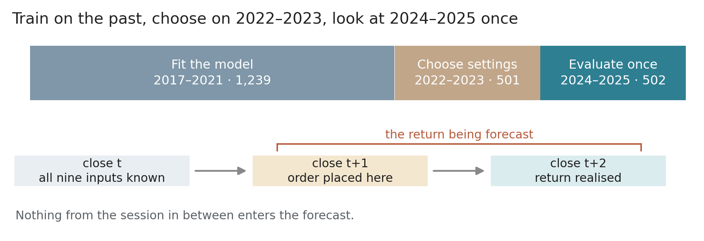
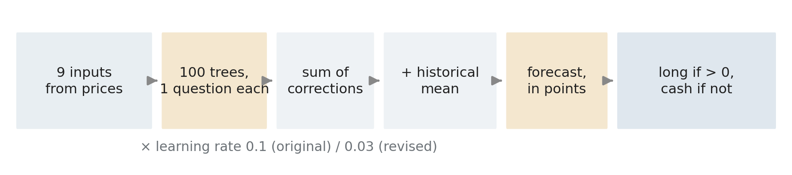
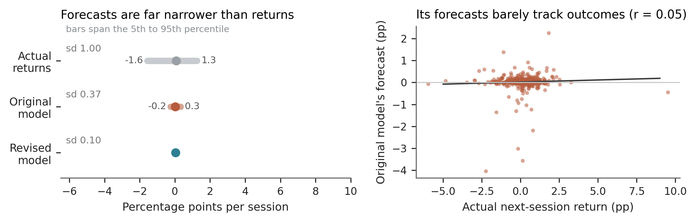
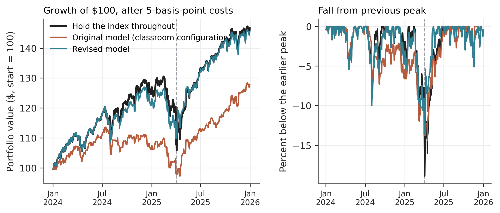

```{r}
#| label: rebuild-blog9
#| include: false
# Rebuild the forecasts, tables and figures, then load every value the article quotes.
input <- knitr::current_input(dir = TRUE)
post_dir <- if (length(input) && nzchar(input)) dirname(normalizePath(input, winslash = "/")) else getwd()
if (!file.exists(file.path(post_dir, "code", "analysis.py"))) stop("Keep code/, data/ and result/ beside index.qmd.")
python <- Sys.getenv("BLOG9_PYTHON", unset = "")
if (!nzchar(python)) python <- Sys.getenv("RETICULATE_PYTHON", unset = "")
if (!nzchar(python)) python <- Sys.which("python")
if (!nzchar(python)) python <- Sys.which("python3")
if (!nzchar(python)) stop("Python not found. See README.md and set BLOG9_PYTHON if needed.")
log <- tempfile(fileext = ".txt")
status <- system2(python, args = shQuote(file.path(post_dir, "code", "analysis.py")), stdout = log, stderr = log)
if (status != 0) stop(paste0("Blog 9 analysis failed: ", paste(readLines(log, warn = FALSE, encoding = "UTF-8"), collapse = "\n")))
nums <- read.csv(file.path(post_dir, "result", "tables", "numbers.csv"), check.names = FALSE, stringsAsFactors = FALSE, encoding = "UTF-8")
v <- setNames(as.list(nums$value), nums$key)
```

<style>
/* Scope article styling to Blog 9 so the site's navigation keeps its own layout. */
#quarto-content { display: block !important; }
#title-block-header { display: none; }
#quarto-document-content { display: block !important; width: 100% !important; max-width: none !important; margin: 0 !important; }
.blog9-page, .blog9-page * { box-sizing: border-box; }
.blog9-page { width: 100%; max-width: 828px; margin: 0 auto; padding: 44px 24px 64px; color: #222; }
.blog9-page header { max-width: 660px; margin: 0 auto 40px; font-family: Arial, sans-serif; }
.blog9-page h1 { font: 600 36px/1.17 Arial, sans-serif; letter-spacing: -.6px; margin: 0 0 13px; }
.blog9-page .subtitle { font: 21px/1.45 Arial, sans-serif; color: #595959; margin: 0 0 15px; }
.blog9-page .tags { font: 11px Arial, sans-serif; color: #626970; letter-spacing: .3px; margin: 0 0 25px; }
.blog9-page .tags span { display: inline-block; border: 1px solid #a9afb4; border-radius: 3px; padding: 4px 7px; margin: 0 5px 6px 0; }
.blog9-page .meta { display: flex; gap: 100px; font: 14px Arial, sans-serif; }
.blog9-page .meta small { display: block; color: #777; font-size: 11px; margin-bottom: 6px; }
.blog9-page article { font: 17px/1.67 Georgia, "Times New Roman", serif; max-width: 780px; margin: auto; }
.blog9-page article > p, .blog9-page article > h2, .blog9-page article > section { max-width: 660px; margin-left: auto; margin-right: auto; }
.blog9-page article > p { margin-bottom: 1.1em; }
.blog9-page h2 { font: 700 24px/1.3 Georgia, serif; margin-top: 2em; color: #111; }
.blog9-page mark.research-question { background: #fff0b3; color: inherit; padding: .08em .12em; }
.blog9-page figure.report-figure { display: block; margin: 1.7rem 0 1.9rem; padding: 0; border: 0; }
.blog9-page figcaption { font: 700 17px/1.4 Arial, sans-serif; text-align: left; color: #111; margin: 0 0 .3rem; }
.blog9-page .figure-number { display: inline-block; margin-right: .4em; color: #666; font-weight: 400; font-size: .85em; white-space: nowrap; }
.blog9-page .figure-deck { font: 13.6px/1.45 Arial, sans-serif; color: #666; margin: 0 0 .6rem; }
.blog9-page img.report-chart { display: block; width: 100%; height: auto; margin: 0 auto; }
.blog9-page .figure-source { font: 11.7px/1.5 Arial, sans-serif; color: #777; margin: .45rem 0; }
.blog9-page details { font: 12.2px/1.55 Arial, sans-serif; color: #666; margin-top: .4rem; }
.blog9-page summary { cursor: pointer; }
.blog9-page table { width: 100%; max-width: 660px; margin: 1rem auto 1.6rem; border-collapse: collapse; font: 13.1px/1.45 Arial, sans-serif; }
.blog9-page th, .blog9-page td { padding: .45rem .3rem; border-bottom: 1px solid #ddd; text-align: right; }
.blog9-page th:first-child, .blog9-page td:first-child { text-align: left; }
.blog9-page thead th { border-bottom: 1.5px solid #999; font-weight: 600; color: #333; }
.blog9-page .table-caption { max-width: 660px; margin: 1.5rem auto -.5rem; font: 12.8px/1.4 Arial, sans-serif; color: #444; }
.blog9-page .source-notes { font: 13.4px/1.6 Arial, sans-serif; padding-left: 1.4rem; max-width: 660px; margin: 0 auto; }
.blog9-page .source-notes li { margin-bottom: .75rem; }
.blog9-page code { font: 12px/1.5 "SF Mono", Menlo, monospace; color: #555; background: #f5f6f7; padding: 0 3px; border-radius: 2px; }
.blog9-page a { color: #246e77; text-decoration: underline; overflow-wrap: anywhere; }
.blog9-page sup { font-size: .7em; }
.blog9-page pre { max-width: 660px; margin: 1rem auto 1.4rem; background: #f8f9fa; border: 1px solid #e7e7e7; padding: .85rem 1rem; font-size: 12px; line-height: 1.5; overflow-x: auto; }
@media (max-width: 600px) {
  .blog9-page { padding: 28px 18px 48px; }
  .blog9-page h1 { font-size: 29px; }
  .blog9-page .subtitle { font-size: 18px; }
  .blog9-page .meta { flex-direction: column; gap: 12px; }
  .blog9-page article { font-size: 16px; }
  .blog9-page h2 { font-size: 21px; }
  .blog9-page table { font-size: 12px; }
}
</style>

<div class="blog9-page">
<header>
<h1>Can Simpler Boosting Beat a No-Model Forecast?</h1>
<p class="subtitle">Out-of-sample evidence from the S&amp;P 500, 2024–2025</p>
<p class="tags"><span>Forecasting</span><span>Gradient Boosting</span><span>Machine Learning</span></p>
<p class="meta"><span><small>Published</small>November 16, 2026</span><span><small>Author</small>Scarlett Xie</span></p>
</header>
<article>
<p>Every trading day an investor makes a small bet on the next session: own the S&amp;P 500, or step into cash. Nobody knows tomorrow's winner; what a model can attempt is narrower and harder — which days to be out.</p>

<p><mark class="research-question"><strong>Can a simplified gradient-boosting model beat a no-model forecast of S&amp;P 500 returns out of sample, and did its signals survive trading costs?</strong></mark></p>

<p>Saying "up" every day is already right `r v$bench_dir`% of the time, so a useful model has to beat that, not beat zero.</p>

<h2 id="data-and-target">Data and a tradeable forecast</h2>

<p>Daily S&amp;P 500 closes from FRED, 2017–2025, a price index that excludes dividends.<sup><a href="#note-1">1</a></sup> Each forecast uses nine numbers known at the close — the last five daily returns, cumulative return and volatility over 5 and 20 sessions — and targets one session's return, in percentage points.</p>

<figure class="report-figure" aria-labelledby="figure-1-title">
<figcaption id="figure-1-title"><span class="figure-number">Figure 1.</span> The split, and the window a forecast can be traded in</figcaption>
<p class="figure-deck">Model fitted on 2017–2021, settings chosen on 2022–2023, evaluated once on 2024–2025. A forecast read at close t is acted on at close t+1 and paid off at close t+2.</p>

<p class="figure-source">Source: author's split dates; session counts from <code>result/tables/experiment.json</code>.</p>
<details><summary>Chart notes</summary>
<p>Rows whose outcome was not yet available are dropped, which is why the blocks contain 1,239, 501 and 502 sessions rather than calendar days. The model is frozen inside each period: settings are chosen on the validation block and then refitted on all pre-test data before the evaluation block is touched.</p>
</details>
</figure>

<h2 id="the-original-model">The model we started from</h2>

<p>A gradient-boosted regression: 100 small trees added in sequence, each fitted to the error the previous ones left, the forecast being the historical average plus those corrections scaled by a learning rate (Figure 2); Table 1 lists the settings.</p>

<figure class="report-figure" aria-labelledby="figure-2-title">
<figcaption id="figure-2-title"><span class="figure-number">Figure 2.</span> From nine inputs to a position: how the model produces one number a day</figcaption>
<p class="figure-deck">Each tree is a short stack of yes/no questions about the inputs; its leaves return a correction in percentage points. The corrections are summed, scaled by the learning rate, added to the historical mean, and read as a sign.</p>

<p class="figure-source">Source: author's description of the fitted model; settings in <code>result/tables/experiment.json</code>.</p>
<details><summary>Chart notes</summary>
<p>Depth three means at most eight leaves per tree. The learning rate shrinks every tree's contribution, so no single tree can move the forecast far; the sum over 100 trees is what produces dispersion. In the revised model each tree has one split instead of three, a learning rate of 0.03, and a minimum of 50 sessions per leaf.</p>
</details>
</figure>

<p>The original configuration leaves the model free to carve nine inputs into fine regions. On its training years it looks strong — a typical miss of `r v$train_rmse` points against a target standard deviation of `r v$train_sd` — but out of sample its forecasts span only `r v$basic_fmin` to `r v$basic_fmax` points, are positive `r v$basic_pos`% of the time, and correlate with what happened at `r v$basic_corr` (Figure 3).</p>

<figure class="report-figure" aria-labelledby="figure-3-title">
<figcaption id="figure-3-title"><span class="figure-number">Figure 3.</span> The forecasts are too narrow, and almost unrelated to outcomes</figcaption>
<p class="figure-deck">Left: spread of each series, 5th to 95th percentile with the mean as a dot. Right: the original model's forecast against the return it was trying to predict, 2024–2025.</p>

<p class="figure-source">Source: S&amp;P Dow Jones Indices LLC, S&amp;P 500 via FRED; author's calculations (<code>result/tables/forecast_behaviour.csv</code>).</p>
<details><summary>Chart notes</summary>
<p>A useful forecaster would show a spread comparable to the outcome it predicts and a clearly upward-sloping scatter. Both models instead cluster near their own average — the standard signature of a learner that has extracted almost nothing — and their signs still flip often enough to generate trades.</p>
</details>
</figure>

<p>It loses on every measure: root mean squared error `r v$basic_rmse` against `r v$bench_rmse`, squared error `r v$basic_gap`% higher, direction accuracy `r v$basic_dir`% against `r v$bench_dir`%, and $100 becomes $`r v$basic_end` rather than $`r v$cont_end` (Tables 2 and 3).</p>

<h2 id="why-hard">Why daily returns are hard to forecast</h2>

<p>The signal is tiny against the noise: the index moves about a point a session, any predictor explains a sliver, and misses are news rather than patterns. Relationships go stale as regimes change. And direction is a near-useless target, because "up" is already right `r v$bench_dir`% of the time. Flexibility only makes fitting noise cheaper.</p>

<h2 id="what-changed">What we changed</h2>

<p>Three capacity cuts: learning rate 0.1 → 0.03, depth 3 → 1, minimum leaf 1 → 50 sessions. Each correction is trusted less, each tree may state a single condition, and a rule must hold for 50 sessions before it is used. A fourth change is procedural — the forecast window moves one session later, so the signal can be acted on (Figure 1).</p>

<p>Settings were chosen on 2022–2023 only: validation mean squared error falls from `r v$basic_val_mse` to `r v$reg_val_mse`, `r v$val_gain`% lower, and the three alternatives all scored worse.<sup><a href="#note-2">2</a></sup></p>

<p class="table-caption"><strong>Table 1.</strong> The original and revised models side by side.</p>
<table>
<thead><tr><th></th><th>Original (classroom configuration)</th><th>Revised</th></tr></thead>
<tbody>
<tr><td>Trees</td><td>100</td><td>100</td></tr>
<tr><td>Questions per tree</td><td>3 (up to 8 leaves)</td><td>1</td></tr>
<tr><td>Learning rate</td><td>0.1</td><td>0.03</td></tr>
<tr><td>Minimum leaf</td><td>1 session</td><td>50 sessions</td></tr>
<tr><td>Forecast window</td><td>session after the information date</td><td>one session later, executable</td></tr>
<tr><td>Validation MSE, 2022–2023</td><td>`r v$basic_val_mse`</td><td>`r v$reg_val_mse`</td></tr>
<tr><td>Test RMSE, 2024–2025</td><td>`r v$basic_rmse`</td><td>`r v$reg_rmse`</td></tr>
</tbody></table>

<h2 id="how-much-better">How much better?</h2>

<p>The benchmark repeats the pre-test average, `r v$bench_pp`% a day, and is hard to beat because it never chases noise; error is the root mean squared miss, which punishes large misses more.</p>

<figure class="report-figure" aria-labelledby="figure-4-title">
<figcaption id="figure-4-title"><span class="figure-number">Figure 4.</span> The revision removes the handicap without creating an advantage</figcaption>
<p class="figure-deck">Mean squared error relative to a forecast that repeats the pre-test average, in percent; lower is better. Bars span 95% bootstrap intervals from 2,000 resamples of the `r v$test_sessions` test sessions.</p>

<p class="figure-source">Source: S&amp;P Dow Jones Indices LLC, S&amp;P 500 via FRED; author's calculations.<sup><a href="#note-1">1</a></sup></p>
<details><summary>Chart notes</summary>
<p>The third bar is a rule with no estimation at all: forecast tomorrow with the average of the five most recently realised returns. It is deliberately crude — the point is that a fitted model which scores worse than the simple historical average is also worse than rules a reader could apply by hand.</p>
<p>The gap is 100 × (model test MSE / benchmark test MSE − 1). Intervals come from a paired bootstrap that resamples sessions with replacement, keeping each day's loss and its benchmark counterpart together. Root mean squared error is `r v$bench_rmse` points for the benchmark, `r v$basic_rmse` for the original model and `r v$reg_rmse` for the revision.</p>
</details>
</figure>

<p>The revision removes most of the handicap: squared error falls from `r v$basic_gap`% above the benchmark to `r v$reg_gap`%, and direction accuracy rises from `r v$basic_dir`% to `r v$reg_dir`%, though still not past the benchmark's `r v$bench_dir`%. Yet the interval around the revised gap, `r v$reg_lo` to `r v$reg_hi`%, contains zero, while the original's, `r v$basic_lo` to `r v$basic_hi`%, does not (Diebold–Mariano p = `r v$basic_dm_p`). It closes a gap without opening an advantage.</p>

<p class="table-caption"><strong>Table 2.</strong> Out-of-sample accuracy, 2024–2025 (`r v$test_sessions` sessions).</p>
<table>
<thead><tr><th>Forecaster</th><th>RMSE (pp)</th><th>Gap vs benchmark (%)</th><th>95% interval</th><th>Direction accuracy (%)</th></tr></thead>
<tbody>
<tr><td>Historical mean (benchmark)</td><td>`r v$bench_rmse`</td><td>`r v$bench_gap`</td><td>—</td><td>`r v$bench_dir`</td></tr>
<tr><td>Five-session mean</td><td>`r v$naive_rmse`</td><td>+`r v$naive_gap`</td><td>`r v$naive_lo` to `r v$naive_hi`</td><td>`r v$naive_dir`</td></tr>
<tr><td>Original model</td><td>`r v$basic_rmse`</td><td>+`r v$basic_gap`</td><td>`r v$basic_lo` to `r v$basic_hi`</td><td>`r v$basic_dir`</td></tr>
<tr><td>Revised model</td><td>`r v$reg_rmse`</td><td>+`r v$reg_gap`</td><td>`r v$reg_lo` to `r v$reg_hi`</td><td>`r v$reg_dir`</td></tr>
</tbody></table>

<h2 id="trading-costs">Trading costs decide the verdict</h2>

<p>Hold the index when the forecast is positive, zero-interest cash otherwise; orders at the next close; 5 basis points per one-way trade, including the first purchase and final sale.<sup><a href="#note-3">3</a></sup></p>

<figure class="report-figure" aria-labelledby="figure-5-title">
<figcaption id="figure-5-title"><span class="figure-number">Figure 5.</span> Two years of $100, net of costs</figcaption>
<p class="figure-deck">Left: growth of $100 from the first session of 2024, after 5-basis-point costs on every trade. Right: fall from the highest wealth reached so far. The dashed line marks `r v$trough`, the index's deepest point.</p>

<p class="figure-source">Source: S&amp;P Dow Jones Indices LLC, S&amp;P 500 via FRED; author's calculations. Price returns exclude dividends.<sup><a href="#note-3">3</a></sup></p>
<details><summary>Chart notes</summary>
<p>A positive forecast selects full hypothetical index exposure; otherwise the rule holds zero-interest cash. Forecasts are available before the assumed next-close execution. Continuous exposure makes `r v$cont_trades` one-way trades, the original model `r v$basic_trades`, the revision `r v$reg_trades`. The index is not directly tradable, so these are illustrative index-exposure returns.</p>
</details>
</figure>

<p>Staying invested turns $100 into $`r v$cont_end`; the original model $`r v$basic_end`, the revision $`r v$reg_end` — `r v$gain_pp` points recovered and `r v$trades_cut` fewer trades. Before costs the revision leads, `r v$reg_gbr`% against `r v$cont_gbr`%, but `r v$reg_trades` trades pay for that lead; what remains, `r v$gap_pp` points (`r v$gap_lo` to `r v$gap_hi`), is statistically nothing (Table 3).</p>

<p>Risk looks better — worst fall `r v$reg_mdd`% against `r v$cont_mdd`%, volatility `r v$reg_vol`% against `r v$cont_vol`%, Sharpe ratio `r v$reg_sharpe` against `r v$cont_sharpe` — but not generally: on 31 March 2025 its drawdown was `r v$gap_before_selloff` points <em>deeper</em>, and by December the two had converged. One week explains it: `r v$cash_apr` of its `r v$cash_n` cash sessions fall in April 2025, including the index's worst day; cash days averaged −`r v$cash_ret`% against +`r v$invested_ret`% invested.</p>

<p class="table-caption"><strong>Table 3.</strong> Two-year net return under three cost assumptions.</p>
<table>
<thead><tr><th>Strategy</th><th>0 bp</th><th>5 bp</th><th>10 bp</th></tr></thead>
<tbody>
<tr><td>Hold the index throughout</td><td>`r v$cont_c0`%</td><td>`r v$cont_c5`%</td><td>`r v$cont_c10`%</td></tr>
<tr><td>Original model</td><td>`r v$basic_c0`%</td><td>`r v$basic_c5`%</td><td>`r v$basic_c10`%</td></tr>
<tr><td>Revised model</td><td>`r v$reg_c0`%</td><td>`r v$reg_c5`%</td><td>`r v$reg_c10`%</td></tr>
</tbody></table>

<h2 id="takeaway">Takeaway</h2>

<p>The original model predicted badly — `r v$basic_gap`% worse squared error than a forecast needing no model, `r v$basic_trades` trades, $`r v$basic_end` per $100 — and cutting its freedom repaired that: `r v$reg_gap`%, `r v$reg_trades` trades, $`r v$reg_end`. Repairing a handicap is not creating an edge, though: the interval contains zero, the return still trails buy-and-hold by `r v$gap_pp` points, and the smaller drawdown rests on `r v$cash_n` cash sessions. Because the window was revised after earlier results were seen, these results stay exploratory.</p>

<h2 id="footnotes">Footnotes</h2>
<ol class="source-notes">
<li id="note-1"><strong>Data and trading sessions.</strong> S&amp;P Dow Jones Indices LLC, <a href="https://fred.stlouisfed.org/series/SP500">S&amp;P 500 via FRED</a>. The price index excludes dividends. Missing closes and holidays are removed before returns are computed. Features use closing data through the information date; the target is the one-session return starting at the following close. FRED serves a rolling ten-year history, so the downloaded snapshot is retained with a checksum for exact replication.</li>
<li id="note-2"><strong>Model selection.</strong> Four revised configurations — learning rates of 0.01 to 0.1, depths of one to three, leaf minima of 10 to 50 — are compared on validation mean squared error, and the choice is fixed before the test years are touched. The original model follows the classroom materials: 100 trees, three questions per tree, learning rate 0.1, no minimum leaf size, nine predictors built from recent returns. The column labelled "original" re-estimates that configuration on this sample rather than copying a stored classroom output, so both models are trained on identical data and the comparison is like for like. Because the forecast window was revised after earlier results had been inspected, the revised test results remain exploratory.</li>
<li id="note-3"><strong>Investment assumptions.</strong> No leverage or short selling; cash earns zero. Five basis points means 0.05% per one-way trade, charged on portfolio value at the moment of the trade, including the initial purchase and the final sale. Dividends, cash interest, taxes and tracking error are omitted. The index is not directly tradable, so these are hypothetical index-exposure returns rather than observed ETF returns. Sharpe ratios annualize the mean daily return and divide by annualized daily volatility.</li>
</ol>

<h2 id="reproducibility">Reproducibility</h2>

<p>The project sits beside the article: rendering <code>index.qmd</code> rebuilds every number, table and figure below. Place this folder at <code>blog/posts/post9/</code> in the website project, open it in RStudio and press <strong>Render</strong>. The chunk at the top of the file runs <code>code/analysis.py</code>, which refits the models from <code>data/raw/SP500.csv</code> and rewrites <code>result/</code>; the article text then reads <code>result/tables/numbers.csv</code>, so no value is typed by hand.</p>

<pre><code>index.qmd                   article, layout and render entry point
README.md                   dependencies and replication steps
code/
├── analysis.py             runs the four stages below in order
├── run_model.py            data, features, splits, fitting, forecasts
├── evaluate_investment.py  trading rule, costs, DM tests, bootstrap intervals
├── make_figures.py         five 300-dpi figures
├── article_numbers.py      every value quoted in the text -> numbers.csv
└── test_pipeline.py        twelve checks on the saved outputs
data/
├── raw/SP500.csv           FRED download, unchanged, checksum verified
└── processed/              panel.csv, forecasts.csv
result/
├── figures/                five PNG figures
└── tables/                 metrics, inference, costs, numbers.csv, experiment.json</code></pre>

<p>Required: R with <code>knitr</code> and <code>rmarkdown</code>, Quarto, and Python 3 with pandas, NumPy, scikit-learn, SciPy and Matplotlib. No internet connection is needed after setup. If R cannot find the right interpreter, set <code>BLOG9_PYTHON</code> to its full path. Every stage is seeded (<code>20261116</code>), writes only to <code>data/processed/</code> and <code>result/</code>, and the four stages run in about five seconds, so a re-render reproduces the same tables and figures. The twelve tests in <code>code/test_pipeline.py</code> rebuild the target and lag features from the raw price file, recompute every metric from the saved forecasts, and check that costs only ever hurt and that the bootstrap is seed-deterministic.</p>

</article>
</div>
